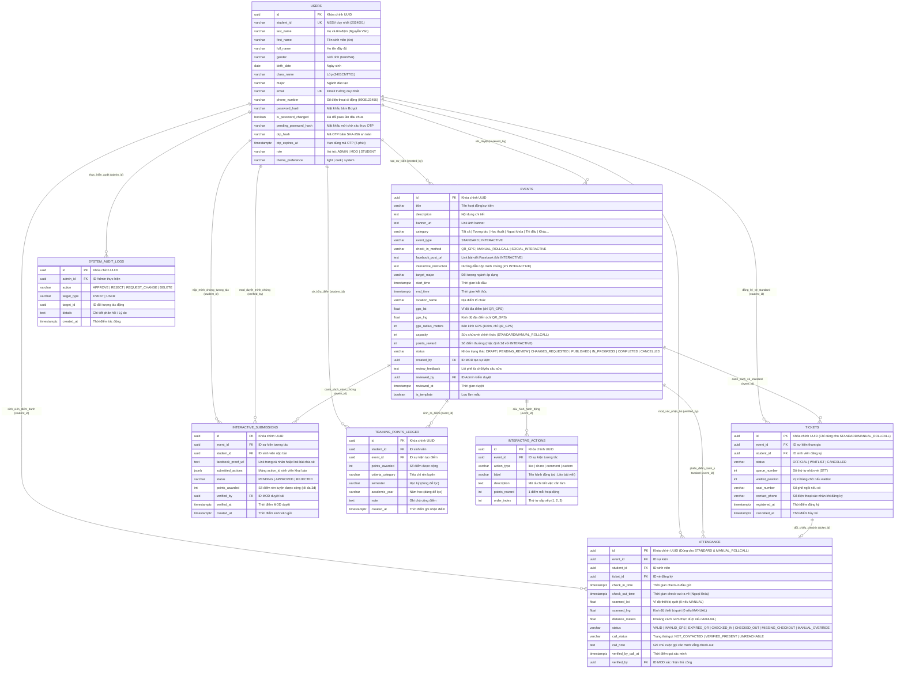

# TÀI LIỆU THIẾT KẾ VÀ TRIỂN KHAI BACKEND TỪNG CHỨC NĂNG
## HỆ THỐNG QUẢN LÝ SỰ KIỆN & ĐIỂM RÈN LUYỆN GDU (GDU EVENT & TRAINING)

> **Phương pháp triển khai chuẩn hóa theo 5 bước (API-First & Data-Driven):**
> 1. **Xác định Database:** Tên bảng, tên trường, kiểu dữ liệu, khóa chính (PK), khóa ngoại (FK), ràng buộc toàn vẹn & mô hình quan hệ (ERD).
> 2. **Xác định API & Dữ liệu I/O:** Endpoint, Method, Header, Request Body/Query, Response thành công (200/201) & các mã lỗi (4xx/5xx).
> 3. **Code Logic Nghiệp vụ:** Quy tắc kiểm tra điều kiện, validation, phân quyền RBAC, các business rules đại học (24h, 48h, GPS 100m, đôn vé...).
> 4. **Kết nối & Thao tác Database:** Truy vấn SQL cụ thể, Transaction ACID, cơ chế khóa hàng chống Race Condition khi tranh vé.
> 5. **Kiểm thử API (Postman / Swagger):** Hướng dẫn kiểm thử thực tế, kịch bản thành công & các kịch bản ngoại lệ dễ hiểu.

---

## MỤC LỤC TỔNG QUAN

1. **PHẦN 1: XÁC ĐỊNH DATABASE: CÁC TÊN TRƯỜNG, KHÓA CHÍNH, KHÓA NGOẠI & MÔ HÌNH QUAN HỆ (ERD)**
   - 1.1. Sơ đồ mô hình quan hệ thực thể (Mermaid ERD)
   - 1.2. Đặc tả chi tiết cấu trúc các bảng dữ liệu
   - 1.3. Ma trận quan hệ & Tính toàn vẹn dữ liệu (Referential Integrity)
   - 1.4. Mã nguồn SQL DDL khởi tạo Database
2. **PHẦN 2: MODULE 1 — AUTHENTICATION & QUẢN LÝ TÀI KHOẢN**
   - Chức năng 1.1: Đăng nhập hệ thống (Sinh viên dùng MSSV / Cán bộ MOD & Admin dùng Email)
   - Chức năng 1.2: Đổi mật khẩu lần đầu & Gửi OTP về Email trường
   - Chức năng 1.3: Xác thực OTP Email trường & Kích hoạt tài khoản
   - Chức năng 1.4: Lấy thông tin tài khoản & Hồ sơ sinh viên (`GET /api/auth/me`) (Đủ 8 thông tin)
   - Chức năng 1.5: Cài đặt hệ thống & Đổi giao diện Theme (`PATCH /api/users/settings`)
3. **PHẦN 3: MODULE 2 — QUẢN LÝ SỰ KIỆN (MOD & ADMIN)**
   - Chức năng 2.1: [MOD] Tạo bản nháp sự kiện mới (Hỗ trợ Sự kiện Tiêu chuẩn & Sự kiện Tương tác Facebook)
   - Chức năng 2.2: [MOD] Cập nhật bản nháp sự kiện & Cấu hình Hành động tương tác / GPS 100m
   - Chức năng 2.3: [MOD] Gửi sự kiện lên Admin xét duyệt
   - Chức năng 2.4: [Admin] Xem danh sách sự kiện chờ duyệt
   - Chức năng 2.5: [Admin] Xét duyệt / Từ chối / Yêu cầu MOD chỉnh sửa sự kiện
   - Chức năng 2.6: [Hệ thống / Admin] Xuất bản sự kiện ra công chúng (Publish)
   - Chức năng 2.7: [MOD] Hủy sự kiện (Cancel Event - Quy tắc trong 24 giờ)
   - Chức năng 2.8: [Admin] Xóa vĩnh viễn sự kiện (Delete Event)
   - Chức năng 2.9: [MOD] Quản lý & Phân loại sự kiện theo 3 nhóm trạng thái (Đang hoạt động, Bản nháp, Đã hoàn tất)
4. **PHẦN 4: MODULE 3 — ĐĂNG KÝ VÉ, SỰ KIỆN NGOẠI KHÓA, TƯƠNG TÁC & HÀNG CHỜ WAITLIST**
   - Chức năng 3.1: [Sinh viên] Khám phá & Lọc sự kiện Public (Tất cả, Tương tác, Học thuật, Ngoại khóa, Thi đấu, Khác)
   - Chức năng 3.2: [Sinh viên] Xem chi tiết sự kiện (Giao diện riêng biệt cho Sự kiện Tiêu chuẩn & Tương tác)
   - Chức năng 3.3: [Sinh viên] Đăng ký vé sự kiện tiêu chuẩn & Quy trình đăng ký Ngoại khóa (Xác nhận SĐT, Popup đối soát, Popup chỉnh sửa khi sai)
   - Chức năng 3.4: [Sinh viên] Xem danh sách vé của tôi & Vị trí hàng chờ (Chỉ áp dụng sự kiện tiêu chuẩn)
   - Chức năng 3.5: [Sinh viên] Hủy vé (Quy tắc 48h từ khi đăng ký & Tự động đôn vé hàng chờ)
   - Chức năng 3.6: [MOD] Quản lý danh sách đăng ký & Danh sách chờ
   - Chức năng 3.7: [Sinh viên] Nộp minh chứng tham gia Sự kiện tương tác Facebook (Không cần vé, 3 điểm rèn luyện)
5. **PHẦN 5: MODULE 4 — VẬN HÀNH ĐIỂM DANH QR/GPS, ĐIỂM DANH NGOẠI KHÓA 2 BƯỚC (CHECK-IN & CHECK-OUT) & ĐỐI SOÁT MINH CHỨNG**
   - Chức năng 4.1: [MOD] Mở phiên Projector & Tạo mã QR động (Refresh 30s)
   - Chức năng 4.2: [Sinh viên] Quét QR kết hợp xác thực GPS (Bán kính 100 mét)
   - Chức năng 4.3: [MOD] Theo dõi Live Attendance & Điểm danh bổ sung thủ công
   - Chức năng 4.4: [MOD] Thống kê, đối soát & Duyệt minh chứng Sự kiện tương tác (Cộng 1đ/hoạt động vào sổ cái)
   - Chức năng 4.5: [MOD] Quy trình điểm danh Ngoại khóa 2 bước: Check-in đầu giờ & Check-out ra về bằng checkbox (Dữ liệu mới từ danh sách check-in, Cảnh báo vắng mặt kèm SĐT, Gọi điện xác minh & Checkbox lại lần nữa)
6. **PHẦN 6: MODULE 5 — QUẢN LÝ ĐIỂM RÈN LUYỆN & BÁO CÁO THỐNG KÊ**
   - Chức năng 5.1: [Hệ thống] Tổng kết sự kiện & Tích lũy điểm rèn luyện (Chu kỳ 3 năm không reset)
   - Chức năng 5.2: [Sinh viên] Tra cứu bảng điểm rèn luyện tích lũy & Lịch sử cộng điểm (QĐ 251)
   - Chức năng 5.3: [MOD] Xem báo cáo chi tiết từng sự kiện & Xuất file Excel (10 cột bắt buộc)
   - Chức năng 5.4: [MOD] Báo cáo tổng hợp & Xuất Excel toàn trường theo năm & theo kỳ (Ma trận đa cột Tên HĐ1 ... Tên HĐn, Tổng điểm, Xếp loại)
7. **PHẦN 7: BẢNG TỔNG HỢP MÃ HTTP STATUS & QUY ƯỚC LỖI TOÀN HỆ THỐNG**

---

# PHẦN 1: XÁC ĐỊNH DATABASE: CÁC TÊN TRƯỜNG, KHÓA CHÍNH, KHÓA NGOẠI & MÔ HÌNH QUAN HỆ (ERD)

## 1.1. Sơ đồ mô hình quan hệ thực thể (ERD Diagram)



---

## 1.2. Đặc tả chi tiết cấu trúc các bảng dữ liệu

### Bảng 1: `users` (Tài khoản người dùng: Sinh viên, Ban tổ chức MOD, Quản trị viên Admin)
| Tên cột | Kiểu dữ liệu | Khóa | Nullable | Mặc định | Diễn giải ý nghĩa nghiệp vụ |
| :--- | :--- | :--- | :--- | :--- | :--- |
| `id` | `UUID` | **PK** | NOT NULL | `gen_random_uuid()` | Khóa chính duy nhất định danh người dùng. |
| `student_id` | `VARCHAR(50)` | **UK** | NULL | NULL | Mã số sinh viên (MSSV). Bắt buộc với Sinh viên (VD: `2024001`). NULL với Admin/MOD. |
| `last_name` | `VARCHAR(100)` | | NOT NULL | | Họ và tên đệm (VD: `Nguyễn Văn`). |
| `first_name` | `VARCHAR(50)` | | NOT NULL | | Tên sinh viên (VD: `An`). |
| `full_name` | `VARCHAR(150)` | | NOT NULL | | Họ và tên đầy đủ (VD: `Nguyễn Văn An`). |
| `gender` | `VARCHAR(10)` | | NOT NULL | `'Nam'` | Giới tính: `'Nam'` hoặc `'Nữ'`. |
| `birth_date` | `DATE` | | NOT NULL | | Ngày tháng năm sinh của sinh viên (VD: `2004-08-15`). |
| `class_name` | `VARCHAR(50)` | | NULL | NULL | Mã lớp sinh hoạt chính quy (VD: `2401CNTT01`). |
| `major` | `VARCHAR(100)` | | NULL | NULL | Ngành đào tạo (VD: `Công nghệ thông tin`). |
| `phone_number` | `VARCHAR(15)` | | NULL | NULL | Số điện thoại liên hệ của sinh viên (VD: `0908123456`). Dùng đối soát điểm danh ngoại khóa. |
| `email` | `VARCHAR(255)` | **UK** | NOT NULL | | Email trường cấp (VD: `2024001@gdu.edu.vn`, `mod@gdu.edu.vn`). Dùng đăng nhập. |
| `password_hash` | `VARCHAR(255)` | | NOT NULL | | Mật khẩu đã băm bằng thuật toán Bcrypt (Salt rounds = 10). |
| `is_password_changed`| `BOOLEAN` | | NOT NULL | `FALSE` | Đánh dấu đã đổi mật khẩu lần đầu chưa. Ban đầu là `FALSE` (dùng pass mặc định). |
| `pending_password_hash`| `VARCHAR(255)` | | NULL | NULL | Mật khẩu mới băm Bcrypt đang chờ sinh viên xác thực OTP qua email trường trước khi kích hoạt chính thức. |
| `otp_hash` | `VARCHAR(255)` | | NULL | NULL | Mã OTP 6 chữ số đã được băm SHA-256 (bảo vệ chống rò rỉ OTP trong DB/Log theo chuẩn OWASP). |
| `otp_expires_at` | `TIMESTAMPTZ` | | NULL | NULL | Thời điểm hết hạn của mã OTP xác thực (hiệu lực 5 phút kể từ lúc gửi). |
| `role` | `VARCHAR(20)` | | NOT NULL | `'STUDENT'` | Phân quyền 3 cấp: `'ADMIN'`, `'MOD'`, `'STUDENT'`. |
| `theme_preference` | `VARCHAR(20)` | | NOT NULL | `'light'` | Giao diện yêu thích của người dùng: `'light'`, `'dark'`, `'system'`. |
| `created_at` | `TIMESTAMPTZ` | | NOT NULL | `CURRENT_TIMESTAMP` | Thời điểm tạo tài khoản trong hệ thống. |
| `updated_at` | `TIMESTAMPTZ` | | NOT NULL | `CURRENT_TIMESTAMP` | Thời điểm cập nhật thông tin gần nhất. |

> [!IMPORTANT]
> **Quy ước Mật khẩu mặc định lần đầu cho Sinh viên:**
> Khi Nhà trường tạo tài khoản, mật khẩu mặc định được tính tự động theo công thức:
> `GDU@ + UPPER(UNACCENT(first_name)) + TO_CHAR(birth_date, 'DDMM')`
> *(Ví dụ: Sinh viên Nguyễn Văn An, sinh ngày 15/08/2004 ➔ Mật khẩu mặc định là `GDU@AN1508`).*

---

### Bảng 2: `events` (Hoạt động & Sự kiện rèn luyện)
| Tên cột | Kiểu dữ liệu | Khóa | Nullable | Mặc định | Diễn giải ý nghĩa nghiệp vụ |
| :--- | :--- | :--- | :--- | :--- | :--- |
| `id` | `UUID` | **PK** | NOT NULL | `gen_random_uuid()` | Khóa chính sự kiện. |
| `title` | `VARCHAR(255)` | | NOT NULL | | Tên hoạt động / sự kiện. |
| `description` | `TEXT` | | NOT NULL | | Nội dung, mục tiêu, yêu cầu sự kiện. |
| `banner_url` | `TEXT` | | NULL | NULL | Đường dẫn hình ảnh banner đại diện sự kiện. |
| `category` | `VARCHAR(50)` | | NOT NULL | | Danh mục: Tương tác, Học thuật, Ngoại khóa, Thi đấu, Khác, Kỹ năng mềm, Tình nguyện... |
| `event_type` | `VARCHAR(20)` | | NOT NULL | `'STANDARD'` | Loại sự kiện: `'STANDARD'` (Sự kiện có vé: tập trung hoặc ngoại khóa) hoặc `'INTERACTIVE'` (Sự kiện tương tác Facebook không vé). |
| `check_in_method`| `VARCHAR(30)` | | NOT NULL | `'QR_GPS'` | Phương thức điểm danh: `'QR_GPS'` (Sự kiện chuẩn trong trường, quét QR đổi 30s & GPS 100m), `'MANUAL_ROLLCALL'` (Sự kiện ngoại khóa ngoài trường, MOD tích chọn checkbox thủ công), `'SOCIAL_INTERACTIVE'` (Sự kiện tương tác Facebook, MOD duyệt minh chứng link bài viết). |
| `facebook_post_url`| `TEXT` | | NULL | NULL | Link bài viết Facebook chính thức cần tương tác (Bắt buộc nếu `event_type = 'INTERACTIVE'`). |
| `interactive_instruction`| `TEXT` | | NULL | NULL | Hướng dẫn nộp link Facebook trang cá nhân hoặc link bài share làm minh chứng. |
| `target_major` | `VARCHAR(100)` | | NOT NULL | `'Toàn trường'` | Giới hạn ngành tham gia (VD: 'Công nghệ thông tin' hoặc 'Toàn trường'). |
| `start_time` | `TIMESTAMPTZ` | | NOT NULL | | Thời gian bắt đầu diễn ra sự kiện. |
| `end_time` | `TIMESTAMPTZ` | | NOT NULL | | Thời gian kết thúc sự kiện. |
| `location_name`| `VARCHAR(255)` | | NOT NULL | | Tên địa điểm (Hội trường A, hoặc 'Rừng Cần Giờ', hoặc 'Trực tuyến (Fanpage Facebook GDU)'). |
| `gps_lat` | `DOUBLE PRECISION`| | NULL | NULL | Vĩ độ địa điểm tổ chức (Bắt buộc cho `QR_GPS`; NULL cho `MANUAL_ROLLCALL` và `SOCIAL_INTERACTIVE`). |
| `gps_lng` | `DOUBLE PRECISION`| | NULL | NULL | Kinh độ địa điểm tổ chức (Bắt buộc cho `QR_GPS`; NULL cho `MANUAL_ROLLCALL` và `SOCIAL_INTERACTIVE`). |
| `gps_radius_meters`| `INT` | | NULL | `100` | Bán kính quét mã cho phép (Mặc định 100m cho `QR_GPS`; NULL cho ngoại khóa ngoài trường và tương tác). |
| `capacity` | `INT` | | NULL | NULL | Sức chứa vé chính thức (Bắt buộc `> 0` cho sự kiện có vé `STANDARD`/`MANUAL_ROLLCALL`; NULL cho `INTERACTIVE` do không giới hạn vé). |
| `points_reward`| `INT` | | NOT NULL | `0` | Số điểm rèn luyện nhận được (Sự kiện tương tác mặc định là 3 điểm, mỗi hành động 1 điểm; Ngoại khóa thường +10 hoặc +15 điểm). |
| `status` | `VARCHAR(30)` | | NOT NULL | `'DRAFT'` | Trạng thái: `DRAFT`, `PENDING_REVIEW`, `APPROVED`, `REJECTED`, `PUBLISHED`, `CANCELLED`. |
| `created_by` | `UUID` | **FK** | NOT NULL | | ID tài khoản MOD tạo bản nháp sự kiện (`users.id`). |
| `review_feedback`| `TEXT` | | NULL | NULL | Lời phê nhận xét của Admin khi Từ chối hoặc Yêu cầu sửa. |
| `reviewed_by` | `UUID` | **FK** | NULL | NULL | ID tài khoản Admin thực hiện xét duyệt (`users.id`). |
| `reviewed_at` | `TIMESTAMPTZ` | | NULL | NULL | Thời gian Admin xét duyệt sự kiện. |
| `is_template` | `BOOLEAN` | | NOT NULL | `FALSE` | Đánh dấu cấu hình sự kiện mẫu để tái sử dụng. |
| `created_at` | `TIMESTAMPTZ` | | NOT NULL | `CURRENT_TIMESTAMP` | Thời điểm tạo bản ghi. |
| `updated_at` | `TIMESTAMPTZ` | | NOT NULL | `CURRENT_TIMESTAMP` | Thời điểm chỉnh sửa gần nhất. |

> [!NOTE]
> **Quy định Nghiệp vụ về 3 Phương thức Vận hành & Điểm danh (`check_in_method`):**
> 1. **Sự kiện Tiêu chuẩn trong trường (`event_type = 'STANDARD'`, `check_in_method = 'QR_GPS'`):**
>    - Bắt buộc cấu hình `capacity > 0`, `gps_lat`, `gps_lng`, bán kính mặc định 100m.
>    - Sử dụng bảng `tickets` (vé chính thức & hàng chờ waitlist tự động).
>    - Điểm danh bằng cơ chế Projector trình chiếu mã QR động đổi 30 giây kết hợp định vị GPS 100m của sinh viên.
> 2. **Sự kiện Ngoại khóa ngoài trường (`category = 'Ngoại khóa'`, `check_in_method = 'MANUAL_ROLLCALL'`):**
>    - Vẫn yêu cầu đăng ký vé qua bảng `tickets` và quản lý `capacity` để kiểm soát số lượng tham gia.
>    - **Vô hiệu hóa Projector và GPS:** Do tổ chức ngoài trường (dã ngoại sinh thái Cần Giờ, thực tế doanh nghiệp...), sinh viên không quét QR.
>    - Ban Tổ chức MOD mở danh sách đăng ký trên điện thoại/laptop, **tích chọn checkbox** sinh viên có mặt thực tế và bấm nút Xác nhận điểm danh. Hệ thống tự động ghi nhận điểm rèn luyện (+15đ) vào Sổ cái tích lũy 3 năm và cập nhật lịch sử cá nhân ngay tức thì.
> 3. **Sự kiện Tương tác mạng xã hội Facebook (`event_type = 'INTERACTIVE'`, `check_in_method = 'SOCIAL_INTERACTIVE'`):**
>    - **Hoàn toàn KHÔNG dùng vé**, không giới hạn số lượng tham gia (`capacity = NULL`), không dùng QR hay GPS.
>    - Mọi sinh viên đều có thể tương tác trực tiếp trên bài viết Fanpage GDU và nộp link Facebook minh chứng.
>    - Điểm rèn luyện tối đa là **3 điểm** (1 điểm cho mỗi hành động like, share, comment hoàn thành), do MOD đối soát và duyệt điểm.

---

### Bảng 2b: `interactive_actions` (Cấu hình danh sách hành động người dùng cần làm)
| Tên cột | Kiểu dữ liệu | Khóa | Nullable | Mặc định | Diễn giải ý nghĩa nghiệp vụ |
| :--- | :--- | :--- | :--- | :--- | :--- |
| `id` | `UUID` | **PK** | NOT NULL | `gen_random_uuid()` | Khóa chính hành động tương tác. |
| `event_id` | `UUID` | **FK** | NOT NULL | | Khóa ngoại trỏ đến sự kiện (`events.id`). |
| `action_type` | `VARCHAR(20)` | | NOT NULL | `'custom'` | Loại hành động: `'like'`, `'share'`, `'comment'`, `'custom'`. |
| `label` | `VARCHAR(255)` | | NOT NULL | | Tên hành động hiển thị (VD: "Like / Thả cảm xúc bài viết"). |
| `description` | `TEXT` | | NULL | NULL | Mô tả yêu cầu chi tiết của hành động. |
| `points_reward`| `INT` | | NOT NULL | `1` | Số điểm rèn luyện cho hành động này (Mặc định chuẩn: 1 điểm / hoạt động). |
| `order_index` | `INT` | | NOT NULL | `1` | Thứ tự hiển thị các hành động (1, 2, 3...). |

---

### Bảng 2c: `interactive_submissions` (Minh chứng tương tác & Đối soát điểm của Sinh viên)
| Tên cột | Kiểu dữ liệu | Khóa | Nullable | Mặc định | Diễn giải ý nghĩa nghiệp vụ |
| :--- | :--- | :--- | :--- | :--- | :--- |
| `id` | `UUID` | **PK** | NOT NULL | `gen_random_uuid()` | Khóa chính bản nộp minh chứng. |
| `event_id` | `UUID` | **FK** | NOT NULL | | ID sự kiện tương tác (`events.id`). |
| `student_id` | `UUID` | **FK** | NOT NULL | | ID sinh viên tham gia (`users.id`). |
| `facebook_proof_url`| `TEXT`| | NOT NULL | | Đường link trang cá nhân Facebook hoặc link bài chia sẻ công khai làm bằng chứng. |
| `submitted_actions`| `JSONB` | | NOT NULL | `'[]'` | Mảng danh sách các `action_id` mà sinh viên tích chọn đã hoàn thành. |
| `status` | `VARCHAR(20)` | | NOT NULL | `'PENDING'` | Trạng thái đối soát: `'PENDING'` (Chờ duyệt), `'APPROVED'` (Đã duyệt), `'REJECTED'` (Từ chối). |
| `points_awarded`| `INT` | | NOT NULL | `0` | Tổng điểm rèn luyện MOD duyệt cấp (Tối đa 3 điểm, tính theo số hành động hợp lệ). |
| `verified_by` | `UUID` | **FK** | NULL | NULL | ID MOD thực hiện đối soát và duyệt điểm (`users.id`). |
| `verified_at` | `TIMESTAMPTZ` | | NULL | NULL | Thời gian MOD hoàn tất đối soát. |
| `created_at` | `TIMESTAMPTZ` | | NOT NULL | `CURRENT_TIMESTAMP` | Thời điểm sinh viên gửi nộp minh chứng. |

*Ràng buộc duy nhất:* `UNIQUE (event_id, student_id)` — Mỗi sinh viên chỉ nộp minh chứng 1 lần cho mỗi sự kiện tương tác.

---

### Bảng 3: `tickets` (Vé tham gia & Hàng chờ Waitlist)
| Tên cột | Kiểu dữ liệu | Khóa | Nullable | Mặc định | Diễn giải ý nghĩa nghiệp vụ |
| :--- | :--- | :--- | :--- | :--- | :--- |
| `id` | `UUID` | **PK** | NOT NULL | `gen_random_uuid()` | Mã vé duy nhất. |
| `event_id` | `UUID` | **FK** | NOT NULL | | Khóa ngoại trỏ đến sự kiện (`events.id`). |
| `student_id` | `UUID` | **FK** | NOT NULL | | Khóa ngoại trỏ đến sinh viên (`users.id`). |
| `status` | `VARCHAR(20)` | | NOT NULL | `'OFFICIAL'` | Trạng thái vé: `'OFFICIAL'` (Chính thức), `'WAITLIST'` (Chờ), `'CANCELLED'` (Đã hủy). |
| `queue_number` | `INT` | | NOT NULL | | Số thứ tự nhận vé (STT cấp phát tuần tự 1, 2, 3...). |
| `waitlist_position`| `INT` | | NULL | NULL | Vị trí trong hàng chờ (nếu `status = 'WAITLIST'`). |
| `seat_number` | `VARCHAR(50)` | | NULL | NULL | Số ghế ngồi (nếu sự kiện có phân bổ ghế). |
| `contact_phone`| `VARCHAR(15)` | | NULL | NULL | Số điện thoại liên hệ xác nhận tại thời điểm sinh viên đăng ký (Dùng cho sự kiện Ngoại khóa). |
| `registered_at`| `TIMESTAMPTZ` | | NOT NULL | `CURRENT_TIMESTAMP` | Thời gian sinh viên bấm đăng ký. |
| `cancelled_at` | `TIMESTAMPTZ` | | NULL | NULL | Thời gian sinh viên hủy vé (trong khung giờ cho phép). |

*Ràng buộc duy nhất:* `UNIQUE (event_id, student_id)` — Mỗi sinh viên chỉ được tạo tối đa 1 vé trong 1 sự kiện.

---

### Bảng 4: `attendance` (Nhật ký Điểm danh Quét mã QR & Xác thực GPS / Điểm danh Ngoại khóa 2 bước Check-in & Check-out)
| Tên cột | Kiểu dữ liệu | Khóa | Nullable | Mặc định | Diễn giải ý nghĩa nghiệp vụ |
| :--- | :--- | :--- | :--- | :--- | :--- |
| `id` | `UUID` | **PK** | NOT NULL | `gen_random_uuid()` | Mã điểm danh. |
| `event_id` | `UUID` | **FK** | NOT NULL | | ID sự kiện được điểm danh (`events.id`). |
| `student_id` | `UUID` | **FK** | NOT NULL | | ID sinh viên check-in (`users.id`). |
| `ticket_id` | `UUID` | **FK** | NOT NULL | | ID vé chính thức (`tickets.id`). |
| `check_in_time`| `TIMESTAMPTZ` | | NOT NULL | `CURRENT_TIMESTAMP` | Thời điểm quét mã hoặc thời điểm MOD xác nhận Check-in đầu giờ. |
| `check_out_time`| `TIMESTAMPTZ`| | NULL | NULL | Thời điểm MOD xác nhận Check-out ra về (Bắt buộc cho sự kiện Ngoại khóa ngoài trường). |
| `scanned_lat` | `DOUBLE PRECISION`| | NOT NULL | `0` | Tọa độ vĩ độ (Nhận từ GPS thiết bị khi quét QR; Gán `0` khi điểm danh thủ công). |
| `scanned_lng` | `DOUBLE PRECISION`| | NOT NULL | `0` | Tọa độ kinh độ (Nhận từ GPS thiết bị khi quét QR; Gán `0` khi điểm danh thủ công). |
| `distance_meters`| `DOUBLE PRECISION`| | NOT NULL | `0` | Khoảng cách GPS thực tế tới sự kiện (Gán `0` khi điểm danh thủ công). |
| `status` | `VARCHAR(30)` | | NOT NULL | `'VALID'` | Kết quả: `'VALID'` (QR hợp lệ), `'CHECKED_IN'` (Ngoại khóa đã check-in đầu giờ), `'CHECKED_OUT'` (Ngoại khóa đã hoàn tất cả check-in và check-out), `'MISSING_CHECKOUT'` (Đã check-in đầu giờ nhưng vắng mặt lúc check-out), `'MANUAL_OVERRIDE'` (Duyệt bù). |
| `call_status` | `VARCHAR(30)` | | NOT NULL | `'NOT_CONTACTED'` | Trạng thái MOD liên hệ sinh viên vắng check-out: `'NOT_CONTACTED'`, `'VERIFIED_PRESENT'` (Đã gọi xác nhận an toàn), `'UNREACHABLE'` (Không nghe máy). |
| `call_note` | `TEXT` | | NULL | NULL | Ghi chú cuộc gọi xác minh vắng mặt của Cán bộ MOD. |
| `verified_by_call_at` | `TIMESTAMPTZ` | | NULL | NULL | Thời điểm MOD thực hiện cuộc gọi xác minh. |
| `verified_by` | `UUID` | **FK** | NULL | NULL | ID MOD xác nhận điểm danh đầu giờ, check-out hoặc gọi điện xác minh. |

---

### Bảng 5: `training_points_ledger` (Sổ cái Điểm Rèn Luyện tích lũy 3 năm liên tục)
| Tên cột | Kiểu dữ liệu | Khóa | Nullable | Mặc định | Diễn giải ý nghĩa nghiệp vụ |
| :--- | :--- | :--- | :--- | :--- | :--- |
| `id` | `UUID` | **PK** | NOT NULL | `gen_random_uuid()` | Khóa chính giao dịch cộng điểm. |
| `student_id` | `UUID` | **FK** | NOT NULL | | Khóa ngoại trỏ đến sinh viên (`users.id`). |
| `event_id` | `UUID` | **FK** | NULL | NULL | ID sự kiện tạo điểm (nếu được cộng từ sự kiện). |
| `points_awarded`| `INT` | | NOT NULL | | Số điểm rèn luyện được cộng (+5, +10, +15...). |
| `criteria_category`| `VARCHAR(100)`| | NOT NULL | | Tiêu chí rèn luyện đánh giá (Học thuật, Kỹ năng, Tình nguyện...). |
| `semester` | `VARCHAR(50)` | | NOT NULL | | Học kỳ ghi nhận (VD: 'HK1 2024-2025' - chỉ dùng để lọc hiển thị). |
| `academic_year`| `VARCHAR(50)` | | NOT NULL | | Năm học ghi nhận (VD: '2024-2025' - chỉ dùng để lọc hiển thị). |
| `note` | `TEXT` | | NULL | NULL | Diễn giải lý do cộng điểm. |
| `created_at` | `TIMESTAMPTZ` | | NOT NULL | `CURRENT_TIMESTAMP` | Thời điểm ghi nhận vào sổ cái (Không bao giờ bị reset). |

---

### Bảng 6: `system_audit_logs` (Nhật ký xử lý kiểm duyệt của Quản trị viên)
| Tên cột | Kiểu dữ liệu | Khóa | Nullable | Mặc định | Diễn giải ý nghĩa nghiệp vụ |
| :--- | :--- | :--- | :--- | :--- | :--- |
| `id` | `UUID` | **PK** | NOT NULL | `gen_random_uuid()` | Mã log kiểm duyệt. |
| `admin_id` | `UUID` | **FK** | NOT NULL | | ID Admin thực hiện hành động (`users.id`). |
| `action` | `VARCHAR(50)` | | NOT NULL | | Hành động: `APPROVE`, `REJECT`, `REQUEST_CHANGE`, `DELETE_EVENT`. |
| `target_type` | `VARCHAR(50)` | | NOT NULL | `'EVENT'` | Loại đối tượng bị tác động. |
| `target_id` | `UUID` | | NOT NULL | | ID đối tượng bị tác động (`events.id`). |
| `details` | `TEXT` | | NULL | NULL | Lời phê nhận xét, lý do từ chối hoặc lý do xóa sự kiện. |
| `created_at` | `TIMESTAMPTZ` | | NOT NULL | `CURRENT_TIMESTAMP` | Thời điểm ghi log. |

---

## 1.3. Ma trận quan hệ bảng & Ràng buộc toàn vẹn dữ liệu

| Bảng nguồn | Khóa ngoại | Bảng đích | Kiểu quan hệ | Hành vi khi xóa (ON DELETE) | Ý nghĩa nghiệp vụ |
| :--- | :--- | :--- | :--- | :--- | :--- |
| `events` | `created_by` | `users.id` | N - 1 | `RESTRICT` | Không được xóa tài khoản MOD nếu đang sở hữu sự kiện. |
| `events` | `reviewed_by`| `users.id` | N - 1 | `SET NULL` | Nếu Admin bị xóa, sự kiện vẫn giữ nguyên lịch sử đã duyệt. |
| `interactive_actions`| `event_id` | `events.id` | N - 1 | `CASCADE` | Khi xóa sự kiện tương tác, danh sách hành động bị xóa theo. |
| `interactive_submissions`| `event_id` | `events.id` | N - 1 | `CASCADE` | Khi xóa sự kiện tương tác, toàn bộ minh chứng nộp bị xóa theo. |
| `interactive_submissions`| `student_id`| `users.id` | N - 1 | `CASCADE` | Khi xóa tài khoản sinh viên, minh chứng nộp bị xóa theo. |
| `interactive_submissions`| `verified_by`| `users.id`| N - 1 | `SET NULL` | Khi xóa MOD, lịch sử duyệt minh chứng vẫn được bảo lưu. |
| `tickets` | `event_id` | `events.id` | N - 1 | `CASCADE` | Khi Admin xóa sự kiện tiêu chuẩn, toàn bộ vé bị xóa theo. |
| `tickets` | `student_id` | `users.id` | N - 1 | `CASCADE` | Khi tài khoản sinh viên bị xóa, các vé liên quan bị xóa theo. |
| `attendance` | `ticket_id` | `tickets.id` | 1 - 1 | `CASCADE` | Mỗi vé điểm danh tối đa 1 lần. |
| `training_points_ledger` | `student_id` | `users.id` | N - 1 | `CASCADE` | Xóa sinh viên thì xóa sổ cái điểm của sinh viên đó. |
| `training_points_ledger` | `event_id` | `events.id` | N - 1 | `SET NULL` | Nếu sự kiện bị xóa, điểm rèn luyện đã cộng cho sinh viên vẫn được bảo lưu! |

---

## 1.4. Mã nguồn SQL DDL khởi tạo Database

```sql
-- Kích hoạt extension sinh UUID
CREATE EXTENSION IF NOT EXISTS "pgcrypto";

-- 1. BẢNG USERS
CREATE TABLE users (
    id UUID PRIMARY KEY DEFAULT gen_random_uuid(),
    student_id VARCHAR(50) UNIQUE,
    last_name VARCHAR(100) NOT NULL,
    first_name VARCHAR(50) NOT NULL,
    full_name VARCHAR(150) NOT NULL,
    gender VARCHAR(10) CHECK (gender IN ('Nam', 'Nữ')) DEFAULT 'Nam',
    birth_date DATE NOT NULL,
    class_name VARCHAR(50),
    major VARCHAR(100),
    email VARCHAR(255) UNIQUE NOT NULL,
    phone_number VARCHAR(15),
    password_hash VARCHAR(255) NOT NULL,
    is_password_changed BOOLEAN DEFAULT FALSE,
    pending_password_hash VARCHAR(255),
    otp_hash VARCHAR(255),
    otp_expires_at TIMESTAMPTZ,
    role VARCHAR(20) NOT NULL CHECK (role IN ('ADMIN', 'MOD', 'STUDENT')),
    theme_preference VARCHAR(20) DEFAULT 'light' CHECK (theme_preference IN ('light', 'dark', 'system')),
    created_at TIMESTAMPTZ DEFAULT CURRENT_TIMESTAMP,
    updated_at TIMESTAMPTZ DEFAULT CURRENT_TIMESTAMP
);

-- Script Migration (Nếu DB đã khởi tạo bảng users trước đó):
-- ALTER TABLE users 
--     ADD COLUMN IF NOT EXISTS phone_number VARCHAR(15),
--     ADD COLUMN IF NOT EXISTS pending_password_hash VARCHAR(255),
--     ADD COLUMN IF NOT EXISTS otp_hash VARCHAR(255),
--     ADD COLUMN IF NOT EXISTS otp_expires_at TIMESTAMPTZ;

-- 2. BẢNG EVENTS (Hỗ trợ Sự kiện Tiêu chuẩn STANDARD, Ngoại khóa ngoài trường & Tương tác INTERACTIVE)
CREATE TABLE events (
    id UUID PRIMARY KEY DEFAULT gen_random_uuid(),
    title VARCHAR(255) NOT NULL,
    description TEXT NOT NULL,
    banner_url TEXT,
    category VARCHAR(50) NOT NULL,
    event_type VARCHAR(20) NOT NULL DEFAULT 'STANDARD' CHECK (event_type IN ('STANDARD', 'INTERACTIVE')),
    check_in_method VARCHAR(30) NOT NULL DEFAULT 'QR_GPS' 
        CHECK (check_in_method IN ('QR_GPS', 'MANUAL_ROLLCALL', 'SOCIAL_INTERACTIVE')),
    facebook_post_url TEXT,
    interactive_instruction TEXT,
    target_major VARCHAR(100) DEFAULT 'Toàn trường',
    start_time TIMESTAMPTZ NOT NULL,
    end_time TIMESTAMPTZ NOT NULL,
    location_name VARCHAR(255) NOT NULL,
    gps_lat DOUBLE PRECISION,
    gps_lng DOUBLE PRECISION,
    gps_radius_meters INT DEFAULT 100,
    capacity INT CHECK (capacity > 0),
    points_reward INT NOT NULL DEFAULT 0,
    status VARCHAR(30) NOT NULL DEFAULT 'DRAFT' 
        CHECK (status IN ('DRAFT', 'PENDING_REVIEW', 'CHANGES_REQUESTED', 'APPROVED', 'REJECTED', 'PUBLISHED', 'IN_PROGRESS', 'COMPLETED', 'CANCELLED')),
    created_by UUID NOT NULL REFERENCES users(id) ON DELETE RESTRICT,
    review_feedback TEXT,
    reviewed_by UUID REFERENCES users(id) ON DELETE SET NULL,
    reviewed_at TIMESTAMPTZ,
    is_template BOOLEAN DEFAULT FALSE,
    created_at TIMESTAMPTZ DEFAULT CURRENT_TIMESTAMP,
    updated_at TIMESTAMPTZ DEFAULT CURRENT_TIMESTAMP
);

-- 2b. BẢNG INTERACTIVE_ACTIONS (Danh sách hành động cấu hình: 1 điểm/hoạt động, mặc định 3 điểm)
CREATE TABLE interactive_actions (
    id UUID PRIMARY KEY DEFAULT gen_random_uuid(),
    event_id UUID NOT NULL REFERENCES events(id) ON DELETE CASCADE,
    action_type VARCHAR(20) NOT NULL CHECK (action_type IN ('like', 'share', 'comment', 'custom')),
    label VARCHAR(255) NOT NULL,
    description TEXT,
    points_reward INT NOT NULL DEFAULT 1 CHECK (points_reward >= 1),
    order_index INT NOT NULL DEFAULT 1
);

-- 2c. BẢNG INTERACTIVE_SUBMISSIONS (Minh chứng nộp link Facebook - Thay thế vé cho loại tương tác)
CREATE TABLE interactive_submissions (
    id UUID PRIMARY KEY DEFAULT gen_random_uuid(),
    event_id UUID NOT NULL REFERENCES events(id) ON DELETE CASCADE,
    student_id UUID NOT NULL REFERENCES users(id) ON DELETE CASCADE,
    facebook_proof_url TEXT NOT NULL,
    submitted_actions JSONB NOT NULL DEFAULT '[]',
    status VARCHAR(20) NOT NULL DEFAULT 'PENDING' CHECK (status IN ('PENDING', 'APPROVED', 'REJECTED')),
    points_awarded INT NOT NULL DEFAULT 0 CHECK (points_awarded >= 0),
    verified_by UUID REFERENCES users(id) ON DELETE SET NULL,
    verified_at TIMESTAMPTZ,
    created_at TIMESTAMPTZ DEFAULT CURRENT_TIMESTAMP,
    UNIQUE (event_id, student_id)
);

-- 3. BẢNG TICKETS
CREATE TABLE tickets (
    id UUID PRIMARY KEY DEFAULT gen_random_uuid(),
    event_id UUID NOT NULL REFERENCES events(id) ON DELETE CASCADE,
    student_id UUID NOT NULL REFERENCES users(id) ON DELETE CASCADE,
    status VARCHAR(20) NOT NULL CHECK (status IN ('OFFICIAL', 'WAITLIST', 'CANCELLED')),
    queue_number INT NOT NULL,
    waitlist_position INT,
    seat_number VARCHAR(50),
    contact_phone VARCHAR(15),
    registered_at TIMESTAMPTZ DEFAULT CURRENT_TIMESTAMP,
    cancelled_at TIMESTAMPTZ,
    UNIQUE (event_id, student_id)
);

-- 4. BẢNG ATTENDANCE (Hỗ trợ QR/GPS và Quy trình Ngoại khóa 2 bước Check-in & Check-out)
CREATE TABLE attendance (
    id UUID PRIMARY KEY DEFAULT gen_random_uuid(),
    event_id UUID NOT NULL REFERENCES events(id) ON DELETE CASCADE,
    student_id UUID NOT NULL REFERENCES users(id) ON DELETE CASCADE,
    ticket_id UUID NOT NULL REFERENCES tickets(id) ON DELETE CASCADE,
    check_in_time TIMESTAMPTZ DEFAULT CURRENT_TIMESTAMP,
    check_out_time TIMESTAMPTZ,
    scanned_lat DOUBLE PRECISION NOT NULL DEFAULT 0,
    scanned_lng DOUBLE PRECISION NOT NULL DEFAULT 0,
    distance_meters DOUBLE PRECISION NOT NULL DEFAULT 0,
    status VARCHAR(30) NOT NULL 
        CHECK (status IN ('VALID', 'INVALID_GPS', 'EXPIRED_QR', 'CHECKED_IN', 'CHECKED_OUT', 'MISSING_CHECKOUT', 'MANUAL_OVERRIDE')),
    call_status VARCHAR(30) DEFAULT 'NOT_CONTACTED'
        CHECK (call_status IN ('NOT_CONTACTED', 'VERIFIED_PRESENT', 'UNREACHABLE')),
    call_note TEXT,
    verified_by_call_at TIMESTAMPTZ,
    verified_by UUID REFERENCES users(id) ON DELETE SET NULL,
    UNIQUE (event_id, student_id)
);

-- 5. BẢNG TRAINING_POINTS_LEDGER (Tích lũy 3 năm liên tục, không reset)
CREATE TABLE training_points_ledger (
    id UUID PRIMARY KEY DEFAULT gen_random_uuid(),
    student_id UUID NOT NULL REFERENCES users(id) ON DELETE CASCADE,
    event_id UUID REFERENCES events(id) ON DELETE SET NULL,
    points_awarded INT NOT NULL CHECK (points_awarded >= 0),
    criteria_category VARCHAR(100) NOT NULL,
    semester VARCHAR(50) NOT NULL,
    academic_year VARCHAR(50) NOT NULL,
    note TEXT,
    created_at TIMESTAMPTZ DEFAULT CURRENT_TIMESTAMP
);

-- 6. BẢNG SYSTEM_AUDIT_LOGS
CREATE TABLE system_audit_logs (
    id UUID PRIMARY KEY DEFAULT gen_random_uuid(),
    admin_id UUID NOT NULL REFERENCES users(id) ON DELETE RESTRICT,
    action VARCHAR(50) NOT NULL,
    target_type VARCHAR(50) NOT NULL DEFAULT 'EVENT',
    target_id UUID NOT NULL,
    details TEXT,
    created_at TIMESTAMPTZ DEFAULT CURRENT_TIMESTAMP
);
```

---

# PHẦN 2: MODULE 1 — AUTHENTICATION & QUẢN LÝ TÀI KHOẢN

---

### Chức năng 1.1: Đăng nhập hệ thống (Sinh viên MSSV / Cán bộ Email)
*Giao diện Frontend tương ứng:* [`src/app/demo/login/page.tsx`](file:///C:/Users/Bi/Downloads/GDU-DIEM_REN_LUYEN/src/app/demo/login/page.tsx)

#### Bước 2 — Xác định API & Dữ liệu I/O
- **Endpoint:** `POST /api/auth/login`
- **Method:** `POST`
- **Quyền truy cập:** Public
- **Request Headers:** `Content-Type: application/json`
- **Request Body (JSON - Đăng nhập Sinh viên):**
  ```json
  {
    "studentId": "2024001",
    "password": "GDU@AN1508" // Cấu trúc mặc định: GDU@ + TEN(không dấu) + ddmm
  }
  ```
- **Request Body (JSON - Đăng nhập Cán bộ MOD / Admin):**
  ```json
  {
    "email": "mod@gdu.edu.vn", // hoặc "admin@gdu.edu.vn"
    "password": "Mod@123"
  }
  ```
- **Response 200 OK (TH1: Lần đầu đăng nhập - Phát hiện mật khẩu mặc định chưa đổi):**
  ```json
  {
    "success": true,
    "requirePasswordChange": true,
    "message": "Phát hiện lần đầu đăng nhập. Bạn đang dùng mật khẩu mặc định của trường, vui lòng thiết lập mật khẩu mới.",
    "student": {
      "studentId": "2024001",
      "fullName": "Nguyễn Văn An",
      "schoolEmail": "2024001@gdu.edu.vn"
    }
  }
  ```
- **Response 200 OK (TH2: Đăng nhập thành công chính thức):**
  ```json
  {
    "success": true,
    "requirePasswordChange": false,
    "message": "Đăng nhập thành công",
    "data": {
      "access_token": "eyJhbGciOiJIUzI1NiIsInR5cCI6IkpXVCJ9...",
      "expires_in": 86400,
      "user": {
        "id": "c1f964a2-1111-4775-9c59-ec588e734bc1",
        "student_id": "2024001",
        "last_name": "Nguyễn Văn",
        "first_name": "An",
        "full_name": "Nguyễn Văn An",
        "gender": "Nam",
        "birth_date": "15/08/2004",
        "class_name": "2401CNTT01",
        "major": "Công nghệ thông tin",
        "email": "2024001@gdu.edu.vn",
        "role": "STUDENT",
        "redirect_url": "/demo/student"
      }
    }
  }
  ```
- **Response Lỗi:**
  - `400 Bad Request`: `{ "success": false, "message": "Vui lòng nhập đầy đủ thông tin đăng nhập." }`
  - `401 Unauthorized`: `{ "success": false, "message": "Thông tin tài khoản hoặc mật khẩu không chính xác." }`

#### Bước 3 — Code Logic Nghiệp vụ
1. Kiểm tra tính hợp lệ của dữ liệu gửi lên: Không được để trống.
2. Xác định luồng:
   - Nếu client gửi `studentId`: Tra cứu tài khoản sinh viên theo `student_id`.
   - Nếu client gửi `email`: Tra cứu tài khoản theo `email`.
3. Kiểm tra mật khẩu mặc định cho Sinh viên:
   - Mật khẩu mặc định có định dạng: `GDU@ + UPPER(UNACCENT(first_name)) + TO_CHAR(birth_date, 'DDMM')`.
   - Nếu cờ `is_password_changed = FALSE` hoặc mật khẩu nhập vào khớp với mật khẩu mặc định: Trả về HTTP 200 kèm `requirePasswordChange: true`, không cấp JWT Token, yêu cầu chuyển sang bước đổi mật khẩu và xác thực email trường.
4. Trường hợp tài khoản đã đổi mật khẩu hoặc là tài khoản Cán bộ (MOD/Admin):
   - So khớp mật khẩu đã băm bằng `bcrypt.compare(password, user.password_hash)`.
   - Nếu khớp: Cấp phát JWT Access Token chứa payload `{ userId: user.id, role: user.role, email: user.email }` có thời hạn 24 giờ.

#### Bước 4 — Kết nối & Thao tác Database
```sql
-- Tra cứu tài khoản sinh viên hoặc cán bộ
SELECT id, student_id, last_name, first_name, full_name, gender, 
       TO_CHAR(birth_date, 'DD/MM/YYYY') AS birth_date,
       class_name, major, email, password_hash, is_password_changed, role, theme_preference
FROM users 
WHERE student_id = $1 OR email = $1 
LIMIT 1;
```

#### Bước 5 — Kiểm thử API (Postman / Swagger)
- **Test case 1 (Sinh viên lần đầu):** Gửi `studentId = "2024001"`, `password = "GDU@AN1508"` ➔ Kết quả: HTTP 200, `requirePasswordChange: true`.
- **Test case 2 (Sinh viên đã đổi pass):** Gửi `studentId = "2024001"`, `password = "MySecurePass@123"` ➔ Kết quả: HTTP 200, trả về token, `redirect_url = "/demo/student"`.
- **Test case 3 (Cán bộ MOD):** Gửi `email = "mod@gdu.edu.vn"`, `password = "Mod@123"` ➔ Kết quả: HTTP 200, `role = "MOD"`, `redirect_url = "/demo/MOD"`.
- **Test case 4 (Sai mật khẩu):** Gửi sai pass ➔ Kết quả: HTTP 401 Unauthorized.

---

### Chức năng 1.2: Đổi mật khẩu lần đầu & Gửi OTP về Email trường
*Giao diện Frontend tương ứng:* Bước 2 trong [`src/app/demo/login/page.tsx`](file:///C:/Users/Bi/Downloads/GDU-DIEM_REN_LUYEN/src/app/demo/login/page.tsx)

#### Bước 2 — Xác định API & Dữ liệu I/O
- **Endpoint:** `POST /api/auth/first-login/change-password`
- **Method:** `POST`
- **Request Body (JSON):**
  ```json
  {
    "studentId": "2024001",
    "newPassword": "NewStudentPassword@2026",
    "confirmPassword": "NewStudentPassword@2026"
  }
  ```
- **Response 200 OK:**
  ```json
  {
    "success": true,
    "message": "Đã lưu mật khẩu mới tạm thời. Mã xác thực gồm 6 chữ số đã được gửi tới email trường: 2024001@gdu.edu.vn",
    "schoolEmail": "2024001@gdu.edu.vn"
  }
  ```
- **Response Lỗi:**
  - `400 Bad Request`: Mật khẩu mới dưới 6 ký tự, xác nhận mật khẩu không khớp, hoặc mật khẩu mới trùng/dùng lại cấu trúc mật khẩu mặc định ban đầu `GDU@...`.

#### Bước 3 — Code Logic Nghiệp vụ
1. Kiểm tra `newPassword` tối thiểu 6 ký tự.
2. Kiểm tra `newPassword !== confirmPassword`.
3. Kiểm tra quy tắc bảo mật: Mật khẩu mới không được bắt đầu bằng `GDU@` và không được trùng mật khẩu mặc định ban đầu.
4. Băm mật khẩu mới bằng `bcrypt.hash(newPassword, 10)` thành `pending_password_hash`.
5. Sinh mã OTP gồm 6 chữ số ngẫu nhiên (VD: `839201`), gán hạn dùng trong 5 phút.
6. **Tiêu chuẩn an ninh bảo mật cao cấp (OWASP / NIST SP 800-63B):** Băm mã OTP bằng thuật toán SHA-256 (`crypto.createHash('sha256').update(otpCode).digest('hex')`) để lưu vào cột `otp_hash`. Tuyệt đối **không lưu mã OTP dạng văn bản thô (plain text)** trong database nhằm ngăn chặn nguy cơ rò rỉ mã xác thực qua database snapshot, log hay quyền truy cập DBA.
7. Gửi email chứa mã OTP thô (6 chữ số) đến địa chỉ email trường của sinh viên (`2024001@gdu.edu.vn`).

#### Bước 4 — Kết nối & Thao tác Database
```sql
-- Cập nhật mật khẩu tạm và mã OTP đã băm SHA-256 có hiệu lực 5 phút
UPDATE users 
SET pending_password_hash = $1, 
    otp_hash = $2, -- $2 là chuỗi SHA-256(otp_code)
    otp_expires_at = CURRENT_TIMESTAMP + INTERVAL '5 minutes',
    updated_at = CURRENT_TIMESTAMP
WHERE student_id = $3;
```

#### Bước 5 — Kiểm thử API (Postman / Swagger)
- **Test case 1:** Gửi mật khẩu mới trùng `GDU@AN1508` ➔ Kết quả: HTTP 400 ("Mật khẩu mới không được dùng cấu trúc mật khẩu mặc định").
- **Test case 2:** Gửi mật khẩu hợp lệ ➔ Kết quả: HTTP 200, nhận mã OTP qua hòm thư trường (mã test demo: `839201`).

---

### Chức năng 1.3: Xác thực OTP Email trường & Kích hoạt tài khoản
*Giao diện Frontend tương ứng:* Bước 3 & 4 trong [`src/app/demo/login/page.tsx`](file:///C:/Users/Bi/Downloads/GDU-DIEM_REN_LUYEN/src/app/demo/login/page.tsx)

#### Bước 2 — Xác định API & Dữ liệu I/O
- **Endpoint:** `POST /api/auth/first-login/verify-otp`
- **Method:** `POST`
- **Request Body (JSON):**
  ```json
  {
    "studentId": "2024001",
    "otp": "839201"
  }
  ```
- **Response 200 OK:**
  ```json
  {
    "success": true,
    "message": "Kích hoạt tài khoản và cập nhật mật khẩu mới thành công!",
    "access_token": "eyJhbGciOiJIUzI1NiIsInR5cCI6IkpXVCJ9...",
    "user": {
      "studentId": "2024001",
      "fullName": "Nguyễn Văn An",
      "role": "STUDENT"
    }
  }
  ```
- **Response Lỗi:**
  - `400 Bad Request`: Mã OTP không chính xác hoặc đã hết thời hạn 5 phút.

#### Bước 3 — Code Logic Nghiệp vụ
1. Tìm bản ghi sinh viên theo `studentId`.
2. Băm mã OTP client gửi lên bằng SHA-256: `inputOtpHash = SHA256(otp)`.
3. So khớp `inputOtpHash` với `otp_hash` trong Database (sử dụng constant-time compare để phòng chống Timing Attack).
4. Kiểm tra thời hạn hiệu lực: `otp_expires_at >= CURRENT_TIMESTAMP`.
5. Nếu hợp lệ: Cập nhật `password_hash = pending_password_hash`, chuyển cờ `is_password_changed = TRUE`, đồng thời dọn dẹp xóa sạch `pending_password_hash = NULL`, `otp_hash = NULL`, `otp_expires_at = NULL`.
6. Tạo JWT Token đăng nhập chính thức và trả về cho Frontend tự động chuyển hướng vào [`/demo/student`](file:///C:/Users/Bi/Downloads/GDU-DIEM_REN_LUYEN/src/app/demo/student).

#### Bước 4 — Kết nối & Thao tác Database
```sql
UPDATE users 
SET password_hash = pending_password_hash,
    pending_password_hash = NULL,
    otp_hash = NULL,
    otp_expires_at = NULL,
    is_password_changed = TRUE,
    updated_at = CURRENT_TIMESTAMP
WHERE student_id = $1 
  AND otp_hash = $2 -- $2 là chuỗi SHA-256(otp)
  AND otp_expires_at >= CURRENT_TIMESTAMP;
```

#### Bước 5 — Kiểm thử API (Postman / Swagger)
- **Test case 1:** Nhập sai mã OTP (VD: `000000`) ➔ HTTP 400 ("Mã xác thực không chính xác").
- **Test case 2:** Nhập đúng mã OTP (`839201`) ➔ HTTP 200, tài khoản kích hoạt thành công, trả về JWT Token.

---

### Chức năng 1.4: Lấy thông tin tài khoản & Hồ sơ sinh viên (`GET /api/auth/me`)
*Giao diện Frontend tương ứng:* [`src/app/demo/student/profile/page.tsx`](file:///C:/Users/Bi/Downloads/GDU-DIEM_REN_LUYEN/src/app/demo/student/profile/page.tsx)

#### Bước 2 — Xác định API & Dữ liệu I/O
- **Endpoint:** `GET /api/auth/me`
- **Method:** `GET`
- **Request Headers:** `Authorization: Bearer <access_token>`
- **Response 200 OK (Đầy đủ 8 thông tin cá nhân sinh viên):**
  ```json
  {
    "success": true,
    "data": {
      "id": "c1f964a2-1111-4775-9c59-ec588e734bc1",
      "student_id": "2024001",
      "last_name": "Nguyễn Văn",
      "first_name": "An",
      "full_name": "Nguyễn Văn An",
      "gender": "Nam",
      "birth_date": "15/08/2004",
      "class_name": "2401CNTT01",
      "major": "Công nghệ thông tin",
      "email": "2024001@gdu.edu.vn",
      "role": "STUDENT",
      "total_training_points": 85,
      "classification": "Giỏi",
      "theme_preference": "light"
    }
  }
  ```
- **Response Lỗi:** `401 Unauthorized` (Token hết hạn hoặc không hợp lệ).

#### Bước 3 — Code Logic Nghiệp vụ
1. Middleware `authenticateToken` giải mã header `Authorization` lấy `userId`.
2. Truy vấn dữ liệu đầy đủ 8 trường thông tin từ bảng `users`.
3. Tính tổng điểm rèn luyện tích lũy 3 năm liên tục từ bảng `training_points_ledger`.
4. Tính xếp loại theo Quyết định 251/2023/GDU/QĐ-HT (>=90: Xuất sắc, >=80: Giỏi, >=65: Khá, >=50: Trung bình, <50: Yếu).

#### Bước 4 — Kết nối & Thao tác Database
```sql
-- Lấy thông tin hồ sơ
SELECT id, student_id, last_name, first_name, full_name, gender, 
       TO_CHAR(birth_date, 'DD/MM/YYYY') AS birth_date,
       class_name, major, email, role, theme_preference
FROM users WHERE id = $1;

-- Tính tổng điểm rèn luyện tích lũy 3 năm không reset
SELECT COALESCE(SUM(points_awarded), 0) AS total_points
FROM training_points_ledger
WHERE student_id = $1;
```

#### Bước 5 — Kiểm thử API (Postman / Swagger)
- Gửi GET với Bearer Token hợp lệ ➔ HTTP 200, trả về đầy đủ 8 trường thông tin cá nhân và tổng điểm rèn luyện tích lũy.

---

### Chức năng 1.5: Cài đặt hệ thống & Đổi giao diện Theme
*Giao diện Frontend tương ứng:* [`src/app/demo/settings/page.tsx`](file:///C:/Users/Bi/Downloads/GDU-DIEM_REN_LUYEN/src/app/demo/settings/page.tsx)

#### Bước 2 — Xác định API & Dữ liệu I/O
- **Endpoint:** `PATCH /api/users/settings`
- **Method:** `PATCH`
- **Request Headers:** `Authorization: Bearer <access_token>`
- **Request Body (JSON):**
  ```json
  {
    "theme": "dark" // "light" | "dark" | "system"
  }
  ```
- **Response 200 OK:**
  ```json
  {
    "success": true,
    "message": "Đã lưu cài đặt giao diện thành công.",
    "theme": "dark"
  }
  ```

#### Bước 3 — Code Logic Nghiệp vụ
1. Validate giá trị `theme` chỉ được phép là 1 trong 3 giá trị: `'light'`, `'dark'`, `'system'`.
2. Cập nhật `theme_preference` cho người dùng hiện tại trong bảng `users`.

#### Bước 4 — Kết nối & Thao tác Database
```sql
UPDATE users 
SET theme_preference = $1, updated_at = CURRENT_TIMESTAMP 
WHERE id = $2;
```

#### Bước 5 — Kiểm thử API (Postman / Swagger)
- Gửi PATCH với `theme = "dark"` ➔ HTTP 200, Database lưu `theme_preference = 'dark'`.

---

# PHẦN 3: MODULE 2 — QUẢN LÝ SỰ KIỆN (MOD & ADMIN)

---

### Chức năng 2.1: [MOD] Tạo bản nháp sự kiện mới (Hỗ trợ Sự kiện Tiêu chuẩn & Sự kiện Tương tác Facebook)
*Giao diện Frontend tương ứng:* [`src/app/demo/MOD/events/new/page.tsx`](file:///C:/Users/Bi/Downloads/GDU-DIEM_REN_LUYEN/src/app/demo/MOD/events/new/page.tsx)

#### Bước 2 — Xác định API & Dữ liệu I/O
- **Endpoint:** `POST /api/mod/events`
- **Method:** `POST`
- **Quyền:** MOD (`requireRole('MOD')`)
- **Request Body (JSON - Trường hợp 1: Sự kiện Tiêu chuẩn / STANDARD):**
  ```json
  {
    "eventType": "STANDARD",
    "title": "Hội thảo Kỹ năng phỏng vấn và viết CV ấn tượng",
    "description": "Hướng dẫn viết CV chuyên nghiệp và kỹ năng trả lời phỏng vấn...",
    "category": "Kỹ năng mềm",
    "targetMajor": "Toàn trường",
    "startTime": "2026-10-25T08:00:00Z",
    "endTime": "2026-10-25T11:30:00Z",
    "locationName": "Hội trường cơ sở Tân Sơn Nhất",
    "gpsLat": 10.8015,
    "gpsLng": 106.6658,
    "gpsRadiusMeters": 100,
    "capacity": 200,
    "pointsReward": 15,
    "isTemplate": false
  }
  ```
- **Request Body (JSON - Trường hợp 2: Sự kiện Tương tác Facebook / INTERACTIVE):**
  ```json
  {
    "eventType": "INTERACTIVE",
    "title": "Chiến dịch Tương tác Fanpage: Lan tỏa Chào đón Tân sinh viên K18",
    "description": "Sinh viên tham gia tương tác trực tiếp trên bài viết Fanpage GDU để nhận điểm rèn luyện...",
    "category": "Tương tác",
    "targetMajor": "Toàn trường",
    "startTime": "2026-10-14T08:00:00Z",
    "endTime": "2026-10-24T23:59:00Z",
    "locationName": "Trực tuyến (Fanpage Facebook GDU)",
    "facebookPostUrl": "https://www.facebook.com/GiaDinhUniversity/posts/pfbid02V9xk7m8L3b4q",
    "interactiveInstruction": "Hoàn thành các hành động: Like (+1đ), Share công khai (+1đ), Comment tag bạn bè (+1đ). Dán link trang cá nhân Facebook làm minh chứng.",
    "pointsReward": 3,
    "actions": [
      {
        "type": "like",
        "label": "Like / Thả cảm xúc bài viết",
        "description": "Bấm Thích hoặc Thả tim bài viết chào đón K18 trên Fanpage",
        "points": 1
      },
      {
        "type": "share",
        "label": "Chia sẻ bài viết ở chế độ Công khai",
        "description": "Chia sẻ về trang cá nhân Facebook kèm hashtag #GDU_K18",
        "points": 1
      },
      {
        "type": "comment",
        "label": "Bình luận gắn thẻ 3 người bạn & gửi lời chúc",
        "description": "Để lại bình luận chào mừng năm học mới và gắn thẻ 3 bạn",
        "points": 1
      }
    ],
    "isTemplate": false
  }
  ```
- **Response 201 Created:**
  ```json
  {
    "success": true,
    "message": "Tạo bản nháp sự kiện thành công.",
    "data": {
      "id": "e2e8317c-2222-4444-9999-aaaaaaaaaaaa",
      "status": "DRAFT",
      "eventType": "INTERACTIVE",
      "title": "Chiến dịch Tương tác Fanpage: Lan tỏa Chào đón Tân sinh viên K18",
      "pointsReward": 3,
      "requiresTickets": false
    }
  }
  ```

#### Bước 3 — Code Logic Nghiệp vụ
1. Kiểm tra quyền: Người tạo phải có role là `MOD`.
2. Kiểm tra thời gian: `startTime < endTime`.
3. Phân nhánh theo loại sự kiện:
   - **Nếu `eventType === 'STANDARD'`:** Bắt buộc có `capacity > 0`, `gpsLat`, `gpsLng`. Sự kiện này sẽ sử dụng hệ thống vé `tickets` và điểm danh GPS.
   - **Nếu `eventType === 'INTERACTIVE'`:**
     - Bắt buộc cung cấp `facebookPostUrl` (định dạng URL hợp lệ trỏ tới Facebook).
     - Bắt buộc danh sách `actions` (tối thiểu 1 hành động, thông thường 3 hành động: Like, Share, Comment).
     - Mỗi hành động được cấu hình 1 điểm rèn luyện, tổng điểm tối đa là 3 điểm (`pointsReward = 3`).
     - **Không yêu cầu vé:** Các trường `capacity`, `gpsLat`, `gpsLng` được đặt thành `NULL`. Mọi sinh viên đều có quyền tham gia không giới hạn số lượng.
4. Mặc định gán `status = 'DRAFT'`.

#### Bước 4 — Kết nối & Thao tác Database
```sql
BEGIN;

-- 1. Tạo sự kiện chính
INSERT INTO events (
    title, description, category, event_type, facebook_post_url, interactive_instruction,
    target_major, start_time, end_time, location_name, 
    gps_lat, gps_lng, gps_radius_meters, capacity, 
    points_reward, status, created_by, is_template
) VALUES (
    $1, $2, $3, $4, $5, $6,
    $7, $8, $9, $10,
    $11, $12, $13, $14,
    $15, 'DRAFT', $16, $17
) RETURNING id, status, title, event_type;

-- 2. Nếu là sự kiện tương tác: Chèn danh sách các hành động tương tác (actions)
INSERT INTO interactive_actions (event_id, action_type, label, description, points_reward, order_index)
VALUES 
    ($event_id, 'like', 'Like / Thả cảm xúc bài viết', 'Bấm Thích hoặc Thả tim...', 1, 1),
    ($event_id, 'share', 'Chia sẻ bài viết công khai', 'Share về trang cá nhân...', 1, 2),
    ($event_id, 'comment', 'Bình luận gắn thẻ 3 người bạn', 'Comment kèm tag bạn bè...', 1, 3);

COMMIT;
```

#### Bước 5 — Kiểm thử API (Postman / Swagger)
- MOD gửi payload Sự kiện tương tác (`eventType = "INTERACTIVE"`) ➔ HTTP 201 Created, `requiresTickets: false`, bản ghi `interactive_actions` được khởi tạo với 3 hành động (mỗi hành động 1đ).
- MOD gửi payload Sự kiện tiêu chuẩn (`eventType = "STANDARD"`) ➔ HTTP 201 Created, `requiresTickets: true`.
- Sinh viên gửi request tạo sự kiện ➔ HTTP 403 Forbidden.

---

### Chức năng 2.2: [MOD] Cập nhật bản nháp sự kiện & Cấu hình Hành động tương tác / GPS 100m
*Giao diện Frontend tương ứng:* [`src/app/demo/MOD/events/[eventId]/page.tsx`](file:///C:/Users/Bi/Downloads/GDU-DIEM_REN_LUYEN/src/app/demo/MOD/events/[eventId]/page.tsx)

#### Bước 2 — Xác định API & Dữ liệu I/O
- **Endpoint:** `PUT /api/mod/events/:eventId`
- **Method:** `PUT`
- **Quyền:** MOD (`requireRole('MOD')`)
- **Request Headers:** `Authorization: Bearer <access_token>`, `Content-Type: application/json`
- **Request Body (JSON - Cập nhật Sự kiện Tiêu chuẩn hoặc Ngoại khóa):**
  ```json
  {
    "title": "Hội thảo Kỹ năng phỏng vấn và viết CV ấn tượng (Cập nhật)",
    "description": "Nội dung cập nhật bổ sung diễn giả doanh nghiệp và mở rộng sức chứa...",
    "category": "Học thuật",
    "checkInMethod": "QR_GPS",
    "targetMajor": "Toàn trường",
    "startTime": "2026-10-25T08:30:00Z",
    "endTime": "2026-10-25T11:45:00Z",
    "locationName": "Hội trường cơ sở Tân Sơn Nhất - Tầng 3",
    "gpsLat": 10.80155,
    "gpsLng": 106.66582,
    "gpsRadiusMeters": 100,
    "capacity": 250,
    "pointsReward": 15
  }
  ```
- **Request Body (JSON - Cập nhật Sự kiện Tương tác Facebook):**
  ```json
  {
    "title": "Chiến dịch Tương tác Fanpage: Lan tỏa Chào đón Tân sinh viên K18",
    "description": "Cập nhật link bài viết chính thức từ Fanpage Trường Đại học Gia Định...",
    "category": "Tương tác",
    "checkInMethod": "SOCIAL_INTERACTIVE",
    "startTime": "2026-10-14T08:00:00Z",
    "endTime": "2026-10-24T23:59:00Z",
    "locationName": "Trực tuyến (Fanpage Facebook GDU)",
    "facebookPostUrl": "https://www.facebook.com/GiaDinhUniversity/posts/pfbid02V9xk7m8L3b4q",
    "interactiveInstruction": "Thực hiện like, share công khai và comment tag bạn bè...",
    "pointsReward": 3,
    "actions": [
      {
        "type": "like",
        "label": "Like / Thả cảm xúc bài viết",
        "description": "Bấm Thích hoặc Thả tim bài viết chào đón K18 trên Fanpage GDU",
        "points": 1
      },
      {
        "type": "share",
        "label": "Chia sẻ bài viết ở chế độ Công khai",
        "description": "Chia sẻ về trang cá nhân Facebook kèm hashtag #GDU_K18",
        "points": 1
      },
      {
        "type": "comment",
        "label": "Bình luận gắn thẻ 3 người bạn & gửi lời chúc",
        "description": "Để lại bình luận chào mừng năm học mới và gắn thẻ 3 bạn",
        "points": 1
      }
    ]
  }
  ```
- **Response 200 OK:**
  ```json
  {
    "success": true,
    "message": "Cập nhật bản nháp sự kiện thành công.",
    "data": {
      "id": "e2e8317c-2222-4444-9999-aaaaaaaaaaaa",
      "status": "DRAFT",
      "title": "Hội thảo Kỹ năng phỏng vấn và viết CV ấn tượng (Cập nhật)",
      "updatedAt": "2026-10-15T10:00:00Z"
    }
  }
  ```
- **Response Lỗi:**
  - `400 Bad Request`: Thiếu trường dữ liệu bắt buộc hoặc thời gian kết thúc trước thời gian bắt đầu.
  - `403 Forbidden`: Người cập nhật không phải là MOD tạo sự kiện này.
  - `422 Unprocessable Entity`: Sự kiện đang ở trạng thái `PENDING_REVIEW` hoặc `PUBLISHED` (Không cho phép chỉnh sửa khi đang duyệt hoặc đã công khai).

#### Bước 3 — Code Logic Nghiệp vụ
1. Xác thực quyền MOD và quyền sở hữu bản ghi:
   `SELECT id, created_by, status, event_type FROM events WHERE id = $eventId`.
2. Kiểm tra điều kiện chỉnh sửa: `status IN ('DRAFT', 'REJECTED')`. Nếu trạng thái khác ➔ Trả về `422 Unprocessable Entity`.
3. Kiểm tra tính toàn vẹn: `startTime < endTime`.
4. Nếu sự kiện là `INTERACTIVE`:
   - Kiểm tra `facebookPostUrl` đúng định dạng URL Facebook.
   - Cập nhật thông tin sự kiện trong bảng `events`.
   - Xóa và chèn lại các hành động trong bảng `interactive_actions` tương ứng với mảng `actions` gửi lên.
5. Nếu sự kiện là `STANDARD` / `MANUAL_ROLLCALL`:
   - Cập nhật các trường địa điểm, `capacity`, tọa độ GPS và bán kính kiểm tra (nếu `QR_GPS`).

#### Bước 4 — Kết nối & Thao tác Database
```sql
BEGIN;

-- 1. Cập nhật thông tin bảng events
UPDATE events
SET title = $1,
    description = $2,
    category = $3,
    check_in_method = $4,
    facebook_post_url = $5,
    interactive_instruction = $6,
    target_major = $7,
    start_time = $8,
    end_time = $9,
    location_name = $10,
    gps_lat = $11,
    gps_lng = $12,
    gps_radius_meters = $13,
    capacity = $14,
    points_reward = $15,
    updated_at = CURRENT_TIMESTAMP
WHERE id = $16 AND created_by = $17 AND status IN ('DRAFT', 'REJECTED');

-- 2. Nếu là sự kiện tương tác: Đồng bộ lại bảng interactive_actions
DELETE FROM interactive_actions WHERE event_id = $16;

INSERT INTO interactive_actions (event_id, action_type, label, description, points_reward, order_index)
VALUES 
    ($16, 'like', $likeLabel, $likeDesc, 1, 1),
    ($16, 'share', $shareLabel, $shareDesc, 1, 2),
    ($16, 'comment', $commentLabel, $commentDesc, 1, 3);

COMMIT;
```

#### Bước 5 — Kiểm thử API (Postman / Swagger)
- MOD cập nhật sự kiện ở trạng thái `DRAFT` ➔ HTTP 200, dữ liệu và danh sách actions được cập nhật.
- MOD cố tình sửa sự kiện đã `PUBLISHED` ➔ HTTP 422 ("Không thể chỉnh sửa sự kiện đã công khai").
- MOD khác không sở hữu sự kiện gửi request cập nhật ➔ HTTP 403 Forbidden.

---

### Chức năng 2.3: [MOD] Gửi sự kiện lên Admin xét duyệt
#### Bước 2 — Xác định API & Dữ liệu I/O
- **Endpoint:** `POST /api/mod/events/:eventId/submit`
- **Method:** `POST`
- **Response 200 OK:**
  ```json
  {
    "success": true,
    "message": "Đã gửi sự kiện lên Ban Quản trị xét duyệt.",
    "status": "PENDING_REVIEW"
  }
  ```

#### Bước 3 — Code Logic Nghiệp vụ
1. Kiểm tra sự kiện thuộc quyền của MOD gửi request.
2. Kiểm tra trạng thái hiện tại phải là `DRAFT` hoặc `REJECTED`.
3. Cập nhật `status = 'PENDING_REVIEW'`.

#### Bước 4 — Kết nối & Thao tác Database
```sql
UPDATE events 
SET status = 'PENDING_REVIEW', updated_at = CURRENT_TIMESTAMP
WHERE id = $1 AND created_by = $2 AND status IN ('DRAFT', 'REJECTED')
RETURNING id, status;
```

#### Bước 5 — Kiểm thử API (Postman / Swagger)
- MOD gửi request ➔ HTTP 200, status chuyển thành `PENDING_REVIEW`.

---

### Chức năng 2.4: [Admin] Xem danh sách sự kiện chờ duyệt
*Giao diện Frontend tương ứng:* [`src/app/demo/admin/reviews/page.tsx`](file:///C:/Users/Bi/Downloads/GDU-DIEM_REN_LUYEN/src/app/demo/admin/reviews/page.tsx)

#### Bước 2 — Xác định API & Dữ liệu I/O
- **Endpoint:** `GET /api/admin/reviews`
- **Method:** `GET`
- **Quyền:** Admin (`requireRole('ADMIN')`)
- **Request Headers:** `Authorization: Bearer <access_token>`
- **Query Params:**
  - `status`: `PENDING_REVIEW` (mặc định), hoặc `ALL`, `APPROVED`, `REJECTED`
  - `category`: Lọc theo danh mục sự kiện (nếu có)
- **Response 200 OK:**
  ```json
  {
    "success": true,
    "data": [
      {
        "id": "evt-standard-01",
        "title": "Hội thảo Kỹ năng phỏng vấn và viết CV ấn tượng",
        "category": "Học thuật",
        "eventType": "STANDARD",
        "checkInMethod": "QR_GPS",
        "startTime": "2026-10-25T08:00:00Z",
        "endTime": "2026-10-25T11:30:00Z",
        "locationName": "Hội trường cơ sở Tân Sơn Nhất",
        "capacity": 200,
        "pointsReward": 15,
        "status": "PENDING_REVIEW",
        "submittedAt": "2026-10-15T09:00:00Z",
        "creator": {
          "id": "c1f964a2-mod-4775-9c59-ec588e734bc1",
          "fullName": "Ban Cố Vấn Đoàn Hội GDU",
          "email": "mod@gdu.edu.vn"
        }
      },
      {
        "id": "evt-interactive-01",
        "title": "Chiến dịch Tương tác Fanpage: Lan tỏa Chào đón Tân sinh viên K18",
        "category": "Tương tác",
        "eventType": "INTERACTIVE",
        "checkInMethod": "SOCIAL_INTERACTIVE",
        "startTime": "2026-10-14T08:00:00Z",
        "endTime": "2026-10-24T23:59:00Z",
        "locationName": "Trực tuyến (Fanpage Facebook GDU)",
        "capacity": null,
        "pointsReward": 3,
        "status": "PENDING_REVIEW",
        "submittedAt": "2026-10-14T10:00:00Z",
        "creator": {
          "id": "c1f964a2-mod-4775-9c59-ec588e734bc1",
          "fullName": "Ban Cố Vấn Đoàn Hội GDU",
          "email": "mod@gdu.edu.vn"
        }
      }
    ]
  }
  ```
- **Response Lỗi:**
  - `401 Unauthorized`: Chưa đăng nhập hoặc token không hợp lệ.
  - `403 Forbidden`: Người dùng không có quyền Quản trị viên (`ADMIN`).

#### Bước 3 — Code Logic Nghiệp vụ
1. Middleware RBAC xác thực `user.role === 'ADMIN'`.
2. Mặc định truy vấn các sự kiện đang chờ xét duyệt (`status = 'PENDING_REVIEW'`).
3. JOIN với bảng `users` (`events.created_by = users.id`) để lấy đầy đủ họ tên và email của MOD đề xuất.
4. Sắp xếp thứ tự ưu tiên: Sự kiện gửi duyệt sớm hơn hiển thị trước (`ORDER BY events.updated_at ASC`).

#### Bước 4 — Kết nối & Thao tác Database
```sql
SELECT 
    e.id, e.title, e.category, e.event_type, e.check_in_method,
    e.start_time, e.end_time, e.location_name, e.capacity, e.points_reward,
    e.status, e.updated_at AS submitted_at,
    u.id AS creator_id, u.full_name AS creator_name, u.email AS creator_email
FROM events e
JOIN users u ON e.created_by = u.id
WHERE ($1::text = 'ALL' OR e.status = COALESCE($1, 'PENDING_REVIEW'))
  AND ($2::text IS NULL OR e.category = $2)
ORDER BY e.updated_at ASC;
```

#### Bước 5 — Kiểm thử API (Postman / Swagger)
- Admin gọi GET ➔ HTTP 200, nhận danh sách sự kiện chờ duyệt kèm thông tin MOD tạo.
- MOD hoặc Sinh viên gọi API này ➔ HTTP 403 Forbidden.

---

### Chức năng 2.5: [Admin] Xét duyệt / Từ chối / Yêu cầu MOD chỉnh sửa sự kiện
*Giao diện Frontend tương ứng:* [`src/app/demo/admin/reviews/[eventId]/page.tsx`](file:///C:/Users/Bi/Downloads/GDU-DIEM_REN_LUYEN/src/app/demo/admin/reviews/[eventId]/page.tsx)

#### Bước 2 — Xác định API & Dữ liệu I/O
- **Endpoint:** `POST /api/admin/reviews/:eventId/decision`
- **Method:** `POST`
- **Quyền:** Admin (`requireRole('ADMIN')`)
- **Request Body (JSON):**
  ```json
  {
    "action": "APPROVE", // "APPROVE" | "REJECT" | "REQUEST_CHANGE"
    "feedback": "Nội dung đạt chuẩn, duyệt công khai trên hệ thống."
  }
  ```
- **Response 200 OK:**
  ```json
  {
    "success": true,
    "message": "Đã xử lý xét duyệt sự kiện thành công.",
    "status": "APPROVED" // Hoặc "PUBLISHED" nếu tự động xuất bản
  }
  ```

#### Bước 3 — Code Logic Nghiệp vụ
1. Kiểm tra quyền Admin.
2. Kiểm tra sự kiện có trạng thái `PENDING_REVIEW`.
3. Nếu `action = 'APPROVE'`: Chuyển status thành `PUBLISHED` để sinh viên có thể xem và đăng ký.
4. Nếu `action = 'REJECT'` hoặc `REQUEST_CHANGE`: Lưu lời phê `feedback` để MOD đọc và sửa lại.
5. Ghi nhật ký vào bảng `system_audit_logs`.

#### Bước 4 — Kết nối & Thao tác Database
```sql
BEGIN;

-- Cập nhật trạng thái sự kiện
UPDATE events 
SET status = CASE 
        WHEN $1 = 'APPROVE' THEN 'PUBLISHED'
        WHEN $1 = 'REJECT' THEN 'REJECTED'
        ELSE 'DRAFT'
    END,
    review_feedback = $2,
    reviewed_by = $3,
    reviewed_at = CURRENT_TIMESTAMP
WHERE id = $4 AND status = 'PENDING_REVIEW';

-- Ghi nhật ký kiểm duyệt Admin
INSERT INTO system_audit_logs (admin_id, action, target_type, target_id, details)
VALUES ($3, $1, 'EVENT', $4, $2);

COMMIT;
```

#### Bước 5 — Kiểm thử API (Postman / Swagger)
- Admin duyệt `APPROVE` ➔ HTTP 200, sự kiện chuyển sang `PUBLISHED`.
- MOD cố tình gọi API này ➔ HTTP 403 Forbidden.

---

### Chức năng 2.6: [Hệ thống / Admin] Xuất bản sự kiện ra công chúng (Publish)
*Giao diện Frontend tương ứng:* Nút Xuất bản trong [`src/app/demo/admin/reviews/[eventId]/page.tsx`](file:///C:/Users/Bi/Downloads/GDU-DIEM_REN_LUYEN/src/app/demo/admin/reviews/[eventId]/page.tsx)

#### Bước 2 — Xác định API & Dữ liệu I/O
- **Endpoint:** `POST /api/admin/events/:eventId/publish`
- **Method:** `POST`
- **Quyền:** Admin (`requireRole('ADMIN')`)
- **Request Headers:** `Authorization: Bearer <access_token>`, `Content-Type: application/json`
- **Request Body (JSON):**
  ```json
  {
    "notifyStudents": true
  }
  ```
- **Response 200 OK:**
  ```json
  {
    "success": true,
    "message": "Sự kiện đã được xuất bản chính thức ra toàn trường thành công.",
    "data": {
      "id": "evt-standard-01",
      "title": "Hội thảo Kỹ năng phỏng vấn và viết CV ấn tượng",
      "status": "PUBLISHED",
      "publishedAt": "2026-10-15T10:30:00Z"
    }
  }
  ```
- **Response Lỗi:**
  - `403 Forbidden`: Người thực hiện không phải Admin (MOD không có quyền tự Public sự kiện).
  - `404 Not Found`: Không tìm thấy sự kiện.
  - `422 Unprocessable Entity`: Sự kiện chưa được duyệt (`status !== 'APPROVED'` hoặc `status !== 'PENDING_REVIEW'`), hoặc sự kiện đã xuất bản trước đó.

#### Bước 3 — Code Logic Nghiệp vụ
1. Kiểm tra quyền Admin: MOD và Sinh viên tuyệt đối không được phép gọi endpoint này (Theo PRD & AGENTS.md: "MOD không được tự Public").
2. Lấy trạng thái hiện tại của sự kiện:
   - Nếu sự kiện đang ở `DRAFT` hoặc `REJECTED`: Trả về `422 Unprocessable Entity` ("Sự kiện chưa qua kiểm duyệt, không thể xuất bản").
   - Nếu sự kiện đã ở `PUBLISHED`: Trả về `400 Bad Request` ("Sự kiện đã được xuất bản trước đó").
3. Chuyển `status = 'PUBLISHED'`, cập nhật `updated_at = CURRENT_TIMESTAMP`.
4. Ghi nhận nhật ký audit log trong bảng `system_audit_logs`.

#### Bước 4 — Kết nối & Thao tác Database
```sql
BEGIN;

-- 1. Chuyển trạng thái xuất bản
UPDATE events 
SET status = 'PUBLISHED', updated_at = CURRENT_TIMESTAMP
WHERE id = $1 AND status IN ('APPROVED', 'PENDING_REVIEW')
RETURNING id, title, status, updated_at AS published_at;

-- 2. Ghi nhật ký kiểm duyệt Admin
INSERT INTO system_audit_logs (admin_id, action, target_type, target_id, details)
VALUES ($2, 'APPROVE', 'EVENT', $1, 'Admin xuất bản sự kiện ra công chúng');

COMMIT;
```

#### Bước 5 — Kiểm thử API (Postman / Swagger)
- Admin gọi POST ➔ HTTP 200, sự kiện chuyển sang `PUBLISHED`, xuất hiện ngay lập tức trên trang Sinh viên.
- MOD cố tình gọi POST ➔ HTTP 403 Forbidden ("MOD không có quyền xuất bản sự kiện").

---

### Chức năng 2.7: [MOD] Hủy sự kiện (Quy tắc giới hạn trong 24 giờ)
#### Bước 2 — Xác định API & Dữ liệu I/O
- **Endpoint:** `POST /api/mod/events/:eventId/cancel`
- **Method:** `POST`
- **Response Lỗi (Vi phạm 24h):**
  ```json
  {
    "success": false,
    "message": "Không thể hủy sự kiện! Quy định không cho phép hủy khi chỉ còn dưới 24 giờ trước giờ bắt đầu."
  }
  ```

#### Bước 3 — Code Logic Nghiệp vụ
1. Lấy thông tin `start_time` của sự kiện.
2. Kiểm tra điều kiện thời gian: `start_time - CURRENT_TIMESTAMP > INTERVAL '24 hours'`. Nếu nhỏ hơn hoặc bằng 24 giờ ➔ Trả về `422 Unprocessable Entity`.
3. Cập nhật `status = 'CANCELLED'`.

#### Bước 4 — Kết nối & Thao tác Database
```sql
UPDATE events 
SET status = 'CANCELLED', updated_at = CURRENT_TIMESTAMP
WHERE id = $1 AND created_by = $2 
  AND start_time > (CURRENT_TIMESTAMP + INTERVAL '24 hours');
```

#### Bước 5 — Kiểm thử API (Postman / Swagger)
- Sự kiện còn 10 tiếng bắt đầu ➔ HTTP 422 ("Không thể hủy dưới 24 giờ").
- Sự kiện còn 3 ngày ➔ HTTP 200, chuyển sang `CANCELLED`.

---

### Chức năng 2.8: [Admin] Xóa vĩnh viễn sự kiện (Delete Event)
> [!WARNING]
> **Phân quyền bắt buộc:** Chỉ có Admin mới có quyền Xóa sự kiện. MOD không bao giờ được phép xóa sự kiện.

#### Bước 2 — Xác định API & Dữ liệu I/O
- **Endpoint:** `DELETE /api/admin/events/:eventId`
- **Method:** `DELETE`
- **Quyền:** Admin (`requireRole('ADMIN')`)
- **Response 200 OK:**
  ```json
  {
    "success": true,
    "message": "Đã xóa sự kiện và lưu vết kiểm duyệt thành công."
  }
  ```

#### Bước 3 — Code Logic Nghiệp vụ
1. Kiểm tra người gọi là Admin.
2. Xóa sự kiện (ràng buộc Database `ON DELETE CASCADE` sẽ tự động xóa sạch vé đăng ký trong bảng `tickets`).
3. Ghi audit log `DELETE_EVENT`.

#### Bước 4 — Kết nối & Thao tác Database
```sql
BEGIN;

INSERT INTO system_audit_logs (admin_id, action, target_type, target_id, details)
VALUES ($1, 'DELETE_EVENT', 'EVENT', $2, 'Admin đã xóa sự kiện khỏi hệ thống');

DELETE FROM events WHERE id = $2;

COMMIT;
```

#### Bước 5 — Kiểm thử API (Postman / Swagger)
- MOD gửi request DELETE ➔ HTTP 403 Forbidden.
- Admin gửi request DELETE ➔ HTTP 200 OK.

---

### Chức năng 2.9: [MOD] Quản lý & Phân loại sự kiện theo 3 nhóm trạng thái (Đang hoạt động, Bản nháp, Đã hoàn tất)
*Giao diện Frontend tương ứng:* [`src/app/demo/MOD/events/page.tsx`](file:///C:/Users/Bi/Downloads/GDU-DIEM_REN_LUYEN/src/app/demo/MOD/events/page.tsx) & [`src/app/demo/MOD/page.tsx`](file:///C:/Users/Bi/Downloads/GDU-DIEM_REN_LUYEN/src/app/demo/MOD/page.tsx)

> [!IMPORTANT]
> **Quy định Nghiệp vụ:**
> - Cán bộ MOD quản lý vòng đời sự kiện thông qua 3 phân nhóm trạng thái rõ ràng nhằm tối ưu luồng công việc vận hành hàng ngày:
>   1. **Nhóm Đang hoạt động (`active`)**: Bao gồm các sự kiện đã được Admin duyệt và công khai (`PUBLISHED`), đang mở cổng đăng ký vé, hoặc đang trong thời gian diễn ra hoạt động trực tiếp (`ONGOING`). Đây là các sự kiện cần MOD theo dõi tiến độ đăng ký, quản lý danh sách vé và chuẩn bị điểm danh.
>   2. **Nhóm Bản nháp (`draft`)**: Bao gồm các sự kiện đang soạn thảo (`DRAFT`), các sự kiện đã gửi và đang chờ Admin phê duyệt (`PENDING_APPROVAL`), và các sự kiện bị Admin từ chối yêu cầu bổ sung/chỉnh sửa (`CHANGE_REQUESTED`).
>   3. **Nhóm Đã hoàn tất (`completed`)**: Bao gồm các sự kiện đã hoàn thành tổ chức và kết thúc chu trình điểm danh (`COMPLETED`), các sự kiện đóng tiếp nhận (`CLOSED`), hoặc các sự kiện đã bị hủy bỏ (`CANCELLED`).
> - API hỗ trợ trả về đồng thời:
>   - **Thống kê tổng quan (Stats Counters)**: Số lượng sự kiện thuộc từng nhóm (`activeCount`, `draftCount`, `completedCount`, `totalEvents`) và tổng lượt sinh viên đã đăng ký tham gia (`totalRegistrations`).
>   - **Danh sách sự kiện được lọc**: Lọc theo nhóm trạng thái (`status_group`), danh mục (`category`), và từ khóa tìm kiếm (`search`), kèm dữ liệu tỷ lệ đăng ký (`registeredCount / capacity`).

#### Bước 1 — Xác định Database
- Bảng chính: `events` (lưu trạng thái `status`, danh mục `category`, ngày bắt đầu và kết thúc).
- Bảng liên quan: `tickets` (đếm số lượng vé chính thức `status = 'OFFICIAL'`), `users` (thông tin người phụ trách MOD).

#### Bước 2 — Xác định API & Dữ liệu I/O
- **Endpoint:** `GET /api/mod/events`
- **Method:** `GET`
- **Quyền:** Cán bộ MOD (`requireRole('MOD')`)
- **Request Headers:**
  ```http
  Authorization: Bearer <access_token>
  ```
- **Query Parameters:**
  - `status_group` (tùy chọn): `all` (mặc định) | `active` | `draft` | `completed`
  - `category` (tùy chọn): `all` | `Tương tác` | `Học thuật` | `Ngoại khóa` | `Thi đấu` | `Khác`
  - `search` (tùy chọn): Tìm kiếm theo tiêu đề sự kiện hoặc địa điểm tổ chức
  - `page` (tùy chọn, mặc định `1`): Trang hiện tại
  - `limit` (tùy chọn, mặc định `10`): Số lượng sự kiện mỗi trang
- **Response 200 OK:**
  ```json
  {
    "success": true,
    "stats": {
      "totalEvents": 14,
      "activeCount": 6,
      "draftCount": 4,
      "completedCount": 4,
      "totalRegistrations": 1285
    },
    "data": [
      {
        "id": "evt-extracurricular-01",
        "title": "Chuyến xe Tình nguyện & Trải nghiệm Sinh thái Rừng Cần Giờ 2026",
        "category": "Ngoại khóa",
        "eventType": "STANDARD",
        "status": "PUBLISHED",
        "statusGroup": "active",
        "startTime": "2026-10-26T06:30:00Z",
        "endTime": "2026-10-26T17:00:00Z",
        "locationName": "Khu dự trữ sinh quyển Rừng ngập mặn Cần Giờ",
        "capacity": 80,
        "registeredCount": 78,
        "pointsReward": 15,
        "checkInMethod": "MANUAL_LIST",
        "createdAt": "2026-10-10T09:00:00Z"
      },
      {
        "id": "evt-draft-02",
        "title": "Hội thảo Định hướng Nghề nghiệp & Gặp gỡ Doanh nghiệp IT 2026",
        "category": "Học thuật",
        "eventType": "STANDARD",
        "status": "DRAFT",
        "statusGroup": "draft",
        "startTime": "2026-11-15T08:00:00Z",
        "endTime": "2026-11-15T11:30:00Z",
        "locationName": "Hội trường Trụ sở Tân Sơn Nhất",
        "capacity": 200,
        "registeredCount": 0,
        "pointsReward": 10,
        "checkInMethod": "QR_PROJECTOR_GPS",
        "createdAt": "2026-10-12T14:20:00Z"
      }
    ],
    "pagination": {
      "currentPage": 1,
      "totalPages": 2,
      "pageSize": 10,
      "totalRecords": 14
    }
  }
  ```
- **Response Lỗi:**
  - `401 Unauthorized`: Chưa truyền Access Token hoặc Token hết hạn.
  - `403 Forbidden`: Người dùng không có quyền MOD (Sinh viên gọi API này).

#### Bước 3 — Code Logic Nghiệp vụ
1. Xác thực danh tính MOD từ JWT payload.
2. Ánh xạ tham số `status_group` sang tập hợp các giá trị `status` tương ứng trong Database:
   - `active` ➔ `('PUBLISHED')` (kèm điều kiện `end_time >= CURRENT_TIMESTAMP`).
   - `draft` ➔ `('DRAFT', 'PENDING_APPROVAL', 'CHANGE_REQUESTED')`.
   - `completed` ➔ `('CANCELLED')` hoặc các sự kiện `PUBLISHED` có `end_time < CURRENT_TIMESTAMP`.
   - `all` ➔ Không lọc theo trạng thái, lấy toàn bộ.
3. Thực hiện truy vấn tổng hợp (Aggregation) để tính toán 4 chỉ số KPI thẻ cards (`totalEvents`, `activeCount`, `draftCount`, `completedCount`, `totalRegistrations`).
4. Truy vấn danh sách sự kiện có phân trang, tính toán `registeredCount` bằng subquery đếm số vé `OFFICIAL`.
5. Bổ sung trường tính toán `statusGroup` cho từng bản ghi trả về để Frontend hiển thị huy hiệu (Badge) và Tab phù hợp.

#### Bước 4 — Kết nối & Thao tác Database
```sql
-- 1. Thống kê KPI tổng quan theo 3 nhóm trạng thái cho MOD
SELECT 
    COUNT(*) AS total_events,
    COUNT(CASE 
        WHEN status = 'PUBLISHED' AND end_time >= CURRENT_TIMESTAMP THEN 1 
    END) AS active_count,
    COUNT(CASE 
        WHEN status IN ('DRAFT', 'PENDING_APPROVAL', 'CHANGE_REQUESTED') THEN 1 
    END) AS draft_count,
    COUNT(CASE 
        WHEN status = 'CANCELLED' OR (status = 'PUBLISHED' AND end_time < CURRENT_TIMESTAMP) THEN 1 
    END) AS completed_count,
    COALESCE((
        SELECT COUNT(*) 
        FROM tickets t 
        JOIN events e2 ON t.event_id = e2.id 
        WHERE t.status = 'OFFICIAL' AND (e2.created_by = $1 OR $1 IS NULL)
    ), 0) AS total_registrations
FROM events
WHERE created_by = $1 OR $1 IS NULL;

-- 2. Truy vấn danh sách sự kiện theo bộ lọc nhóm trạng thái
SELECT 
    e.id,
    e.title,
    e.category,
    e.event_type,
    e.status,
    CASE 
        WHEN e.status IN ('DRAFT', 'PENDING_APPROVAL', 'CHANGE_REQUESTED') THEN 'draft'
        WHEN e.status = 'CANCELLED' OR e.end_time < CURRENT_TIMESTAMP THEN 'completed'
        ELSE 'active'
    END AS status_group,
    e.start_time,
    e.end_time,
    e.location_name,
    e.capacity,
    e.points_reward,
    e.check_in_method,
    e.created_at,
    (SELECT COUNT(*) FROM tickets t WHERE t.event_id = e.id AND t.status = 'OFFICIAL') AS registered_count
FROM events e
WHERE (e.created_by = $1 OR $1 IS NULL)
  -- Lọc theo status_group
  AND (
      $2 = 'all' OR
      ($2 = 'draft' AND e.status IN ('DRAFT', 'PENDING_APPROVAL', 'CHANGE_REQUESTED')) OR
      ($2 = 'active' AND e.status = 'PUBLISHED' AND e.end_time >= CURRENT_TIMESTAMP) OR
      ($2 = 'completed' AND (e.status = 'CANCELLED' OR (e.status = 'PUBLISHED' AND e.end_time < CURRENT_TIMESTAMP)))
  )
  -- Lọc theo category
  AND ($3 = 'all' OR e.category = $3)
  -- Tìm kiếm từ khóa
  AND ($4 = '' OR e.title ILIKE '%' || $4 || '%' OR e.location_name ILIKE '%' || $4 || '%')
ORDER BY e.created_at DESC
LIMIT $5 OFFSET $6;
```

#### Bước 5 — Kiểm thử API (Postman / Swagger)
- **Test Case 1:** `GET /api/mod/events?status_group=active` ➔ HTTP 200, chỉ trả về các sự kiện đang hoạt động/mở đăng ký, kiểm tra trường `statusGroup: "active"`.
- **Test Case 2:** `GET /api/mod/events?status_group=draft` ➔ HTTP 200, danh sách chứa các sự kiện nháp hoặc đang chờ Admin duyệt.
- **Test Case 3:** `GET /api/mod/events?status_group=completed` ➔ HTTP 200, danh sách chứa các sự kiện đã kết thúc hoặc đã hủy.
- **Test Case 4:** Sinh viên gọi `GET /api/mod/events` ➔ HTTP 403 Forbidden.

---

# PHẦN 4: MODULE 3 — ĐĂNG KÝ VÉ, SỰ KIỆN NGOẠI KHÓA, TƯƠNG TÁC & HÀNG CHỜ WAITLIST

---

### Chức năng 3.1: [Sinh viên] Khám phá & Lọc sự kiện Public
*Giao diện Frontend tương ứng:* [`src/app/demo/student/events/page.tsx`](file:///C:/Users/Bi/Downloads/GDU-DIEM_REN_LUYEN/src/app/demo/student/events/page.tsx)

#### Bước 2 — Xác định API & Dữ liệu I/O
- **Endpoint:** `GET /api/student/events`
- **Method:** `GET`
- **Quyền:** Sinh viên (`requireRole('STUDENT')`)
- **Query Params:**
  - `category`: `Tất cả` | `Tương tác` | `Học thuật` | `Ngoại khóa` | `Thi đấu` | `Khác` (Mặc định: `Tất cả`)
  - `search`: Từ khóa tìm kiếm theo tiêu đề hoặc địa điểm sự kiện
- **Response 200 OK:**
  ```json
  {
    "success": true,
    "data": [
      {
        "id": "evt-interactive-01",
        "title": "Chiến dịch Tương tác Fanpage: Lan tỏa Chào đón Tân sinh viên K18",
        "category": "Tương tác",
        "eventType": "INTERACTIVE",
        "bannerUrl": "https://placehold.co/800x400/173a67/ffffff?text=K18+Campaign",
        "startTime": "2026-10-14T08:00:00Z",
        "endTime": "2026-10-24T23:59:00Z",
        "locationName": "Trực tuyến (Fanpage Facebook GDU)",
        "pointsReward": 3,
        "requiresTickets": false,
        "participantCount": 846,
        "status": "PUBLISHED"
      },
      {
        "id": "evt-extracurricular-01",
        "title": "Ngày hội Ngoại khóa & Giao lưu Câu lạc bộ GDU Club Fair 2026",
        "category": "Ngoại khóa",
        "eventType": "STANDARD",
        "startTime": "2026-10-26T07:30:00Z",
        "endTime": "2026-10-26T17:00:00Z",
        "locationName": "Khuôn viên Sân trường, cơ sở Tân Sơn Nhất",
        "capacity": 600,
        "registeredCount": 420,
        "pointsReward": 10,
        "requiresTickets": true,
        "status": "PUBLISHED"
      }
    ]
  }
  ```

#### Bước 3 — Code Logic Nghiệp vụ
1. Chỉ trả về các sự kiện có `status = 'PUBLISHED'`.
2. Lọc danh mục theo thanh điều hướng:
   - Nếu `category === 'Tất cả'` hoặc không truyền: Bỏ qua điều kiện lọc danh mục.
   - Nếu `category === 'Khác'`: Lọc các sự kiện có `category NOT IN ('Tương tác', 'Học thuật', 'Ngoại khóa', 'Thi đấu')`.
   - Các trường hợp còn lại: So khớp chính xác `category = $category`.
3. Tìm kiếm theo `search`: So khớp `ILIKE %search%` trên `title` hoặc `location_name`.

#### Bước 4 — Kết nối & Thao tác Database
```sql
SELECT id, title, category, event_type, banner_url, start_time, end_time, 
       location_name, capacity, points_reward, status,
       CASE WHEN event_type = 'INTERACTIVE' THEN FALSE ELSE TRUE END AS requires_tickets
FROM events
WHERE status = 'PUBLISHED'
  AND ($1 = 'Tất cả' OR ($1 = 'Khác' AND category NOT IN ('Tương tác', 'Học thuật', 'Ngoại khóa', 'Thi đấu')) OR category = $1)
  AND ($2::text IS NULL OR title ILIKE '%' || $2 || '%' OR location_name ILIKE '%' || $2 || '%')
ORDER BY start_time ASC;
```

---

### Chức năng 3.2: [Sinh viên] Xem chi tiết sự kiện
*Giao diện Frontend tương ứng:* [`src/app/demo/student/events/[eventId]/page.tsx`](file:///C:/Users/Bi/Downloads/GDU-DIEM_REN_LUYEN/src/app/demo/student/events/[eventId]/page.tsx)

#### Bước 2 — Xác định API & Dữ liệu I/O
- **Endpoint:** `GET /api/student/events/:eventId`
- **Method:** `GET`
- **Quyền:** Sinh viên (`requireRole('STUDENT')`)
- **Request Headers:** `Authorization: Bearer <access_token>`
- **Response 200 OK (Trường hợp 1: Sự kiện Tiêu chuẩn hoặc Ngoại khóa có vé):**
  ```json
  {
    "success": true,
    "data": {
      "id": "evt-standard-01",
      "title": "Hội thảo Kỹ năng phỏng vấn và viết CV ấn tượng",
      "description": "Hướng dẫn viết CV chuyên nghiệp và kỹ năng trả lời phỏng vấn...",
      "category": "Học thuật",
      "eventType": "STANDARD",
      "checkInMethod": "QR_GPS",
      "startTime": "2026-10-25T08:00:00Z",
      "endTime": "2026-10-25T11:30:00Z",
      "locationName": "Hội trường cơ sở Tân Sơn Nhất",
      "capacity": 200,
      "registeredCount": 165,
      "pointsReward": 15,
      "requiresTickets": true,
      "myTicket": {
        "isRegistered": true,
        "ticketId": "tk-001",
        "status": "OFFICIAL",
        "queueNumber": 45,
        "seatNumber": "A-45",
        "registeredAt": "2026-10-15T08:00:00Z"
      }
    }
  }
  ```
- **Response 200 OK (Trường hợp 2: Sự kiện Tương tác Facebook không vé):**
  ```json
  {
    "success": true,
    "data": {
      "id": "evt-interactive-01",
      "title": "Chiến dịch Tương tác Fanpage: Lan tỏa Chào đón Tân sinh viên K18",
      "description": "Sinh viên tham gia tương tác trực tiếp trên bài viết Fanpage GDU...",
      "category": "Tương tác",
      "eventType": "INTERACTIVE",
      "checkInMethod": "SOCIAL_INTERACTIVE",
      "startTime": "2026-10-14T08:00:00Z",
      "endTime": "2026-10-24T23:59:00Z",
      "locationName": "Trực tuyến (Fanpage Facebook GDU)",
      "facebookPostUrl": "https://www.facebook.com/GiaDinhUniversity/posts/pfbid02V9xk7m8L3b4q",
      "interactiveInstruction": "Thực hiện like, share công khai và comment tag bạn bè...",
      "pointsReward": 3,
      "requiresTickets": false,
      "actions": [
        {
          "id": "act-01",
          "actionType": "like",
          "label": "Like / Thả cảm xúc bài viết",
          "description": "Bấm Thích hoặc Thả tim bài viết chào đón K18 trên Fanpage",
          "pointsReward": 1,
          "orderIndex": 1
        },
        {
          "id": "act-02",
          "actionType": "share",
          "label": "Chia sẻ bài viết ở chế độ Công khai",
          "description": "Chia sẻ về trang cá nhân Facebook kèm hashtag #GDU_K18",
          "pointsReward": 1,
          "orderIndex": 2
        },
        {
          "id": "act-03",
          "actionType": "comment",
          "label": "Bình luận gắn thẻ 3 người bạn & gửi lời chúc",
          "description": "Để lại bình luận chào mừng năm học mới và gắn thẻ 3 bạn",
          "pointsReward": 1,
          "orderIndex": 3
        }
      ],
      "mySubmission": {
        "hasSubmitted": true,
        "submissionId": "sub-11223344",
        "status": "PENDING",
        "facebookProofUrl": "https://www.facebook.com/nguyenvanan.gdu",
        "submittedActions": ["act-01", "act-02", "act-03"],
        "pointsAwarded": 0,
        "submittedAt": "2026-10-15T09:30:00Z"
      }
    }
  }
  ```
- **Response Lỗi:**
  - `404 Not Found`: Không tìm thấy sự kiện hoặc sự kiện chưa công khai (`status !== 'PUBLISHED'`).

#### Bước 3 — Code Logic Nghiệp vụ
1. Tra cứu sự kiện từ bảng `events` theo `id`. Nếu không tồn tại hoặc `status !== 'PUBLISHED'` ➔ Trả về `404 Not Found`.
2. Phân nhánh xử lý:
   - **Với Sự kiện Tiêu chuẩn / Ngoại khóa (`requiresTickets = true`):**
     - Đếm số vé `OFFICIAL` hiện có trong bảng `tickets`.
     - Truy vấn vé của sinh viên đang đăng nhập: Nếu có vé, trả về `myTicket` (`isRegistered = true`, số thứ tự `queueNumber`, số ghế `seatNumber`, vị trí chờ `waitlistPosition`).
   - **Với Sự kiện Tương tác Facebook (`requiresTickets = false`):**
     - Truy vấn danh sách hành động từ bảng `interactive_actions` sắp xếp theo `order_index ASC`.
     - Truy vấn lịch sử nộp minh chứng của sinh viên từ bảng `interactive_submissions`: Nếu đã nộp, trả về `mySubmission` (`hasSubmitted = true`, link Facebook đã nộp, trạng thái `status: 'PENDING' | 'APPROVED' | 'REJECTED'`).

#### Bước 4 — Kết nối & Thao tác Database
```sql
-- 1. Lấy thông tin sự kiện
SELECT id, title, description, banner_url, category, event_type, check_in_method,
       facebook_post_url, interactive_instruction, target_major,
       start_time, end_time, location_name, capacity, points_reward, status
FROM events 
WHERE id = $1 AND status = 'PUBLISHED';

-- 2a. Nếu là sự kiện có vé: Lấy vé của sinh viên
SELECT id, status, queue_number, waitlist_position, seat_number, registered_at
FROM tickets 
WHERE event_id = $1 AND student_id = $2;

-- 2b. Nếu là sự kiện tương tác: Lấy danh sách hành động
SELECT id, action_type, label, description, points_reward, order_index
FROM interactive_actions
WHERE event_id = $1
ORDER BY order_index ASC;

-- 2c. Nếu là sự kiện tương tác: Lấy minh chứng đã nộp của sinh viên
SELECT id, facebook_proof_url, submitted_actions, status, points_awarded, created_at AS submitted_at
FROM interactive_submissions
WHERE event_id = $1 AND student_id = $2;
```

#### Bước 5 — Kiểm thử API (Postman / Swagger)
- Sinh viên xem chi tiết Sự kiện Tiêu chuẩn đã có vé ➔ HTTP 200, hiển thị `myTicket.status = "OFFICIAL"`.
- Sinh viên xem Sự kiện Tương tác ➔ HTTP 200, `requiresTickets: false`, hiển thị danh sách 3 hành động tương tác và link bài viết Facebook.

---

### Chức năng 3.3: [Sinh viên] Đăng ký vé sự kiện tiêu chuẩn & Quy trình đăng ký Ngoại khóa (Xác nhận SĐT, Popup đối soát, Popup chỉnh sửa khi sai)
*Giao diện Frontend tương ứng:* Dialog đăng ký đa bước trong [`src/components/events/registration-dialog.tsx`](file:///C:/Users/Bi/Downloads/GDU-DIEM_REN_LUYEN/src/components/events/registration-dialog.tsx) và [`src/app/demo/student/events/[eventId]/page.tsx`](file:///C:/Users/Bi/Downloads/GDU-DIEM_REN_LUYEN/src/app/demo/student/events/[eventId]/page.tsx)

> [!IMPORTANT]
> **Quy định Nghiệp vụ:**
> - Chức năng đăng ký vé này **CHỈ ÁP DỤNG CHO SỰ KIỆN TIÊU CHUẨN (`STANDARD`)**, bao gồm các sự kiện **Ngoại khóa**, **Học thuật**, **Thi đấu**.
> - **Sự kiện Tương tác (`INTERACTIVE`) hoàn toàn KHÔNG CẦN VÉ** ("loại sự kiện tương tác không cần vụ vé"). Sinh viên không đăng ký qua API này, mà trực tiếp nộp link minh chứng qua **Chức năng 3.7**. Nếu gửi request đăng ký vé tới sự kiện tương tác, server sẽ trả về lỗi `400 Bad Request`.
> - **Quy trình Đăng ký Ngoại khóa đa bước nghiêm ngặt (4 bước):**
>   1. **Bước 1 — Nhập thông tin & Tự động điền dữ liệu sẵn có:**
>      - Hệ thống tự động trích xuất và hiển thị ở chế độ chỉ đọc (Read-only) các thông tin sinh viên đã có sẵn trong hồ sơ tài khoản: **Họ và tên sinh viên** (`fullName`) và **Mã số sinh viên** (`studentId`).
>      - Sinh viên bắt buộc nhập **Số điện thoại liên hệ** (`phoneNumber`) đang hoạt động (Định dạng chuẩn di động Việt Nam 10 chữ số: `03x, 05x, 07x, 08x, 09x`). Đây là thông tin thiết yếu phục vụ công tác liên lạc, đảm bảo an toàn và điều phối xe đưa đón của Ban Tổ chức.
>   2. **Bước 2 — Popup Đối soát Thông tin (Review Popup):**
>      - Trước khi gửi đơn đăng ký, hệ thống hiển thị Popup tổng hợp đối soát hiển thị nổi bật 3 trường thông tin cốt lõi: **Họ và tên + Số điện thoại + MSSV** (kèm Ngành và Lớp).
>      - Sinh viên kiểm tra tính chính xác của thông tin trước khi hoàn tất.
>   3. **Bước 3 — Popup Chỉnh sửa Thông tin (Khi phát hiện sai sót):**
>      - Nếu phát hiện số điện thoại nhập nhầm hoặc có sai sót, sinh viên bấm *"Chỉnh sửa lại"*.
>      - Hệ thống mở Popup chỉnh sửa cho phép cập nhật lại số điện thoại hoặc ghi chú bổ sung, sau đó quay lại Popup đối soát để kiểm tra lại.
>   4. **Bước 4 — Xác nhận & Lưu trữ:**
>      - Khi sinh viên bấm *"Xác nhận thông tin chính xác - Đăng ký"*, hệ thống gửi request lên Backend.
>      - Backend lưu số điện thoại liên lạc vào vé (`tickets.contact_phone`), đồng thời cập nhật số điện thoại mới nhất vào hồ sơ sinh viên (`users.phone_number`).
>      - Hệ thống xử lý cấp Vé chính thức (`OFFICIAL`) hoặc đưa vào Danh sách chờ (`WAITLIST`) nếu sự kiện đã kín chỗ theo cơ chế chống nghẽn và chống Race Condition.

#### Bước 1 — Xác định Database
- Bảng chính: `tickets` (lưu `id`, `event_id`, `student_id`, `contact_phone`, `status`, `queue_number`, `waitlist_position`, `seat_number`).
- Bảng liên quan:
  - `events` (kiểm tra `capacity`, `status`, `event_type`).
  - `users` (đọc `full_name`, `student_id`, cập nhật `phone_number` mới nhất nếu thay đổi).

#### Bước 2 — Xác định API & Dữ liệu I/O
- **Endpoint:** `POST /api/student/events/:eventId/register`
- **Method:** `POST`
- **Quyền:** Sinh viên (`requireRole('STUDENT')`)
- **Request Headers:**
  ```http
  Authorization: Bearer <access_token>
  Content-Type: application/json
  ```
- **Request Body (JSON):**
  ```json
  {
    "phoneNumber": "0987654321",
    "confirmCorrect": true,
    "note": "Đăng ký tham gia dã ngoại Rừng Cần Giờ"
  }
  ```
  - `phoneNumber` (string, bắt buộc): Chuỗi 10 chữ số, đúng format số điện thoại di động Việt Nam.
  - `confirmCorrect` (boolean, bắt buộc): Phải là `true` (xác nhận sinh viên đã đối soát qua Popup).
  - `note` (string, tùy chọn): Ghi chú bổ sung từ sinh viên.
- **Response 200 OK (Cấp Vé chính thức thành công):**
  ```json
  {
    "success": true,
    "message": "Đăng ký thành công! Bạn đã nhận vé chính thức.",
    "ticket": {
      "id": "tk-001",
      "status": "OFFICIAL",
      "queueNumber": 45,
      "seatNumber": "A-45",
      "contactPhone": "0987654321",
      "registeredAt": "2026-10-15T08:00:00Z"
    },
    "studentInfo": {
      "fullName": "Nguyễn Văn An",
      "studentId": "22010001",
      "phoneNumber": "0987654321",
      "major": "Công nghệ thông tin",
      "className": "K18-CNTT01"
    }
  }
  ```
- **Response 200 OK (Hết chỗ - Tự động vào Hàng chờ Waitlist):**
  ```json
  {
    "success": true,
    "message": "Sự kiện đã hết chỗ chính thức. Bạn đã được xếp vào Danh sách chờ (Waitlist).",
    "ticket": {
      "id": "tk-002",
      "status": "WAITLIST",
      "waitlistPosition": 5,
      "queueNumber": 205,
      "contactPhone": "0987654321",
      "registeredAt": "2026-10-15T08:00:00Z"
    },
    "studentInfo": {
      "fullName": "Nguyễn Văn An",
      "studentId": "22010001",
      "phoneNumber": "0987654321"
    }
  }
  ```
- **Response Lỗi:**
  - `400 Bad Request`:
    - Định dạng số điện thoại không hợp lệ (`phoneNumber` không khớp regex `^(0[3|5|7|8|9])[0-9]{8}$`).
    - Chưa xác nhận đối soát (`confirmCorrect` khác `true`).
    - Sự kiện thuộc loại tương tác (`event_type = 'INTERACTIVE'`) không dùng vé.
    - Sự kiện chưa được duyệt hoặc đã kết thúc thời gian đăng ký.
  - `409 Conflict`: Sinh viên đã đăng ký sự kiện này trước đó (không được phép đăng ký trùng lặp).

#### Bước 3 — Code Logic Nghiệp vụ & Chống Race Condition
1. Validate dữ liệu đầu vào:
   - Kiểm tra định dạng `phoneNumber` bằng Regex chuẩn Việt Nam.
   - Kiểm tra `confirmCorrect === true`.
2. Mở Database Transaction (`BEGIN`).
3. Khóa dòng sự kiện bằng lệnh `SELECT ... FOR UPDATE` để ngăn chặn Race Condition khi hàng trăm sinh viên cùng nhấn đăng ký tranh các suất vé cuối cùng trong cùng 1 tích tắc.
4. Kiểm tra loại sự kiện:
   - Nếu `event.event_type = 'INTERACTIVE'`: Rollback transaction và ném lỗi `400 Bad Request` ("Sự kiện tương tác không sử dụng vé, vui lòng nộp minh chứng trực tiếp").
   - Nếu `event.status != 'PUBLISHED'`: Rollback và ném lỗi `400 Bad Request`.
5. Kiểm tra tính trùng lặp: Truy vấn `tickets` xem sinh viên đã có vé sự kiện này chưa. Nếu đã tồn tại vé với trạng thái `OFFICIAL` hoặc `WAITLIST` ➔ Rollback và ném lỗi `409 Conflict`.
6. Cập nhật số điện thoại vào hồ sơ sinh viên:
   - Thực thi `UPDATE users SET phone_number = $phoneNumber WHERE id = $studentId`.
7. Đếm số lượng vé chính thức hiện tại: `SELECT COUNT(*) FROM tickets WHERE event_id = $eventId AND status = 'OFFICIAL'`.
8. So sánh với sức chứa `capacity` của sự kiện:
   - **Trường hợp còn chỗ (`count < capacity`):**
     - Tạo vé với `status = 'OFFICIAL'`.
     - Số thứ tự: `queue_number = count + 1`.
     - Số ghế: `seat_number = 'A-' || queue_number`.
   - **Trường hợp đã hết chỗ (`count >= capacity`):**
     - Đếm số lượng sinh viên trong hàng chờ hiện tại: `SELECT COUNT(*) FROM tickets WHERE event_id = $eventId AND status = 'WAITLIST'`.
     - Tạo vé với `status = 'WAITLIST'`.
     - Vị trí hàng chờ: `waitlist_position = waitlist_count + 1`.
     - Số thứ tự: `queue_number = capacity + waitlist_position`.
9. Lưu vé vào cơ sở dữ liệu kèm `contact_phone = $phoneNumber`.
10. Commit Transaction và trả về đối tượng vé kèm thông tin sinh viên đã xác nhận.

#### Bước 4 — Kết nối & Thao tác Database
```sql
BEGIN;

-- 1. Khóa hàng sự kiện tránh Race Condition tranh vé đồng thời
SELECT id, capacity, status, event_type, title 
FROM events 
WHERE id = $1 
FOR UPDATE;

-- 2. Kiểm tra sinh viên đã có vé hay chưa
SELECT id, status 
FROM tickets 
WHERE event_id = $1 AND student_id = $2;

-- 3. Cập nhật số điện thoại liên lạc mới nhất vào hồ sơ sinh viên
UPDATE users 
SET phone_number = $3 
WHERE id = $2;

-- 4. Đếm số lượng vé chính thức hiện tại
SELECT COUNT(*) AS official_count 
FROM tickets 
WHERE event_id = $1 AND status = 'OFFICIAL';

-- 5a. Nếu còn chỗ (official_count < capacity): Chèn vé chính thức
INSERT INTO tickets (
    event_id, student_id, contact_phone, status, 
    queue_number, waitlist_position, seat_number, registered_at
)
VALUES (
    $1, $2, $3, 'OFFICIAL', 
    $official_count + 1, NULL, 'A-' || ($official_count + 1), CURRENT_TIMESTAMP
)
RETURNING id, status, queue_number, waitlist_position, seat_number, contact_phone, registered_at;

-- 5b. Nếu đã hết chỗ: Đếm waitlist hiện tại và chèn vé hàng chờ
-- SELECT COUNT(*) AS waitlist_count FROM tickets WHERE event_id = $1 AND status = 'WAITLIST';
-- INSERT INTO tickets (
--     event_id, student_id, contact_phone, status, 
--     queue_number, waitlist_position, seat_number, registered_at
-- )
-- VALUES (
--     $1, $2, $3, 'WAITLIST', 
--     $capacity + $waitlist_count + 1, $waitlist_count + 1, NULL, CURRENT_TIMESTAMP
-- )
-- RETURNING id, status, queue_number, waitlist_position, seat_number, contact_phone, registered_at;

COMMIT;
```

#### Bước 5 — Kiểm thử API (Postman / Swagger)
- **Test Case 1 (Hợp lệ nhận Vé chính thức):** Gửi request với `phoneNumber = "0987654321"`, `confirmCorrect = true` ➔ HTTP 200, nhận vé `OFFICIAL`, `users.phone_number` được cập nhật thành `"0987654321"`.
- **Test Case 2 (Sai định dạng SĐT):** Gửi `phoneNumber = "12345"` hoặc `"abcd"` ➔ HTTP 400 Bad Request kèm thông báo `"Số điện thoại không đúng định dạng di động Việt Nam"`.
- **Test Case 3 (Chưa xác nhận đối soát):** Gửi `confirmCorrect = false` ➔ HTTP 400 Bad Request kèm thông báo `"Vui lòng đối soát và xác nhận thông tin chính xác"`.
- **Test Case 4 (Đăng ký lại):** Gửi request lần thứ 2 với cùng tài khoản sinh viên ➔ HTTP 409 Conflict.
- **Test Case 5 (Test tải đồng thời tranh vé):** Sử dụng k6 chạy 100 concurrent requests tới sự kiện chỉ còn 5 chỗ ➔ Đúng 5 request nhận `OFFICIAL`, 95 request nhận `WAITLIST`, không có vé trùng số thứ tự.

---

### Chức năng 3.4: [Sinh viên] Xem danh sách vé của tôi & Vị trí hàng chờ
*Giao diện Frontend tương ứng:* [`src/app/demo/student/tickets/page.tsx`](file:///C:/Users/Bi/Downloads/GDU-DIEM_REN_LUYEN/src/app/demo/student/tickets/page.tsx)

#### Bước 2 — Xác định API & Dữ liệu I/O
- **Endpoint:** `GET /api/student/tickets`
- **Method:** `GET`
- **Quyền:** Sinh viên (`requireRole('STUDENT')`)
- **Request Headers:** `Authorization: Bearer <access_token>`
- **Query Params:**
  - `status`: `ALL` (mặc định), `OFFICIAL`, `WAITLIST`, `CANCELLED`
- **Response 200 OK:**
  ```json
  {
    "success": true,
    "data": [
      {
        "ticketId": "tk-001",
        "status": "OFFICIAL",
        "queueNumber": 45,
        "seatNumber": "A-45",
        "waitlistPosition": null,
        "registeredAt": "2026-10-15T08:00:00Z",
        "canCancel": true,
        "event": {
          "id": "evt-standard-01",
          "title": "Hội thảo Kỹ năng phỏng vấn và viết CV ấn tượng",
          "category": "Học thuật",
          "checkInMethod": "QR_GPS",
          "startTime": "2026-10-25T08:00:00Z",
          "endTime": "2026-10-25T11:30:00Z",
          "locationName": "Hội trường cơ sở Tân Sơn Nhất",
          "pointsReward": 15
        }
      },
      {
        "ticketId": "tk-003",
        "status": "OFFICIAL",
        "queueNumber": 12,
        "seatNumber": null,
        "waitlistPosition": null,
        "registeredAt": "2026-10-16T09:00:00Z",
        "canCancel": true,
        "event": {
          "id": "evt-extracurricular-01",
          "title": "Chuyến đi thực tế sinh thái Cần Giờ",
          "category": "Ngoại khóa",
          "checkInMethod": "MANUAL_ROLLCALL",
          "startTime": "2026-10-26T06:00:00Z",
          "endTime": "2026-10-26T18:00:00Z",
          "locationName": "Khu dự trữ sinh quyển Cần Giờ",
          "pointsReward": 15
        }
      },
      {
        "ticketId": "tk-002",
        "status": "WAITLIST",
        "queueNumber": 205,
        "seatNumber": null,
        "waitlistPosition": 5,
        "registeredAt": "2026-10-15T08:10:00Z",
        "canCancel": true,
        "event": {
          "id": "evt-standard-02",
          "title": "Cuộc thi Lập trình Hackathon GDU 2026",
          "category": "Thi đấu",
          "checkInMethod": "QR_GPS",
          "startTime": "2026-11-01T07:30:00Z",
          "endTime": "2026-11-01T17:00:00Z",
          "locationName": "Phòng Lab 402 - Tân Sơn Nhất",
          "pointsReward": 20
        }
      }
    ]
  }
  ```
- **Response Lỗi:**
  - `401 Unauthorized`: Chưa đăng nhập hoặc token không hợp lệ.

#### Bước 3 — Code Logic Nghiệp vụ
1. Xác thực sinh viên từ Bearer Token.
2. Lấy danh sách toàn bộ vé sinh viên đã đăng ký từ bảng `tickets` JOIN với bảng `events`.
3. Kiểm tra tính khả thi hủy vé (`canCancel`):
   - Vé có `status IN ('OFFICIAL', 'WAITLIST')` VÀ thời gian từ lúc đăng ký đến hiện tại không quá 48 giờ (`CURRENT_TIMESTAMP - registered_at <= INTERVAL '48 hours'`) ➔ `canCancel = true`.
   - Ngược lại ➔ `canCancel = false`.
4. Không bao gồm các sự kiện tương tác Facebook vì loại sự kiện này không dùng vé.

#### Bước 4 — Kết nối & Thao tác Database
```sql
SELECT 
    t.id AS ticket_id, t.status, t.queue_number, t.waitlist_position, t.seat_number,
    t.registered_at,
    CASE 
        WHEN t.status != 'CANCELLED' AND t.registered_at >= (CURRENT_TIMESTAMP - INTERVAL '48 hours') 
        THEN TRUE 
        ELSE FALSE 
    END AS can_cancel,
    e.id AS event_id, e.title, e.category, e.check_in_method,
    e.start_time, e.end_time, e.location_name, e.points_reward
FROM tickets t
JOIN events e ON t.event_id = e.id
WHERE t.student_id = $1
  AND ($2::text = 'ALL' OR t.status = COALESCE($2, 'ALL'))
ORDER BY e.start_time ASC;
```

#### Bước 5 — Kiểm thử API (Postman / Swagger)
- Sinh viên gọi GET ➔ HTTP 200, nhận danh sách vé chính thức, vé chờ waitlist và cờ `canCancel`.
- Sau 49 giờ kể từ khi đăng ký, gọi lại API ➔ `canCancel` tự động đổi thành `false`.

---

### Chức năng 3.5: [Sinh viên] Hủy vé (Quy tắc 48h & Tự động đôn vé hàng chờ)
#### Bước 2 — Xác định API & Dữ liệu I/O
- **Endpoint:** `POST /api/student/tickets/:ticketId/cancel`
- **Method:** `POST`
- **Response 200 OK:**
  ```json
  {
    "success": true,
    "message": "Hủy vé thành công. Suất tham gia đã được tự động chuyển cho sinh viên đầu tiên trong danh sách chờ."
  }
  ```
- **Response Lỗi (Quá hạn 48h):**
  ```json
  {
    "success": false,
    "message": "Không thể hủy vé! Đã quá 48 giờ kể từ thời điểm bạn đăng ký vé."
  }
  ```

#### Bước 3 — Code Logic Nghiệp vụ & Tự động đôn vé
1. Mở Transaction.
2. Kiểm tra điều kiện thời gian hủy: `CURRENT_TIMESTAMP - registered_at <= INTERVAL '48 hours'`. Nếu quá 48 giờ ➔ Rollback, trả về `422 Unprocessable Entity`.
3. Đổi trạng thái vé hiện tại thành `status = 'CANCELLED'`.
4. Tìm sinh viên đang đứng đầu danh sách chờ:
   `SELECT id FROM tickets WHERE event_id = $1 AND status = 'WAITLIST' ORDER BY waitlist_position ASC LIMIT 1 FOR UPDATE`.
5. Nếu có người trong hàng chờ:
   - Đôn vé đó thành `status = 'OFFICIAL'`, xóa `waitlist_position`.
   - Cập nhật giảm 1 vị trí cho toàn bộ các sinh viên còn lại trong hàng chờ:
     `UPDATE tickets SET waitlist_position = waitlist_position - 1 WHERE event_id = $1 AND status = 'WAITLIST'`.
6. Commit Transaction.

#### Bước 4 — Kết nối & Thao tác Database
```sql
BEGIN;

-- 1. Hủy vé của sinh viên
UPDATE tickets 
SET status = 'CANCELLED', cancelled_at = CURRENT_TIMESTAMP
WHERE id = $1 AND student_id = $2 
  AND registered_at >= (CURRENT_TIMESTAMP - INTERVAL '48 hours');

-- 2. Tìm người đầu tiên trong Waitlist để đôn vé
SELECT id FROM tickets 
WHERE event_id = $3 AND status = 'WAITLIST' 
ORDER BY waitlist_position ASC LIMIT 1 FOR UPDATE;

-- 3. Đôn thành vé chính thức
UPDATE tickets 
SET status = 'OFFICIAL', waitlist_position = NULL 
WHERE id = $promoted_ticket_id;

-- 4. Giảm số thứ tự hàng chờ cho những người còn lại
UPDATE tickets 
SET waitlist_position = waitlist_position - 1 
WHERE event_id = $3 AND status = 'WAITLIST';

COMMIT;
```

#### Bước 5 — Kiểm thử API (Postman / Swagger)
- Sinh viên hủy vé sau 50 giờ ➔ HTTP 422 ("Quá thời hạn 48 giờ").
- Sinh viên hủy vé sau 2 giờ ➔ HTTP 200, sinh viên Waitlist #1 lập tức được đôn thành Official.

---

### Chức năng 3.7: [Sinh viên] Nộp minh chứng tham gia Sự kiện tương tác Facebook
*Giao diện Frontend tương ứng:* [`src/components/events/interactive-event-detail.tsx`](file:///C:/Users/Bi/Downloads/GDU-DIEM_REN_LUYEN/src/components/events/interactive-event-detail.tsx)

> [!NOTE]
> **Quy định Nghiệp vụ:**
> - Sự kiện tương tác **hoàn toàn không dùng vé**. Sinh viên không cần đặt vé trước, không có hàng chờ waitlist hay số ghế.
> - Sinh viên truy cập bài viết trên Fanpage Facebook chính thức của Trường, hoàn thành các hành động (Like, Share công khai, Bình luận) và gửi link trang cá nhân Facebook hoặc link bài share để làm minh chứng.
> - Mỗi hành động tương tác hoàn thành tương ứng với **1 điểm rèn luyện**, tổng cộng tối đa **3 điểm rèn luyện**.

#### Bước 2 — Xác định API & Dữ liệu I/O
- **Endpoint:** `POST /api/student/events/:eventId/interactive-submissions`
- **Method:** `POST`
- **Quyền:** Sinh viên (`requireRole('STUDENT')`)
- **Request Headers:** `Authorization: Bearer <access_token>`
- **Request Body (JSON):**
  ```json
  {
    "facebookProofUrl": "https://www.facebook.com/nguyenvanan.gdu/posts/pfbid02V9xk7m8L3b4q",
    "completedActionIds": ["act-01", "act-02", "act-03"]
  }
  ```
- **Response 201 Created (Nộp thành công):**
  ```json
  {
    "success": true,
    "message": "Nộp minh chứng thành công! Ban Tổ chức sẽ đối soát và ghi nhận tối đa 3 điểm rèn luyện (1 điểm/hoạt động).",
    "data": {
      "id": "sub-11223344-5555-6666-7777-888899990000",
      "eventId": "evt-interactive-01",
      "status": "PENDING",
      "facebookProofUrl": "https://www.facebook.com/nguyenvanan.gdu/posts/pfbid02V9xk7m8L3b4q",
      "completedActionsCount": 3,
      "maxPotentialPoints": 3,
      "submittedAt": "2026-10-15T09:30:00Z"
    }
  }
  ```
- **Response Lỗi:**
  - `400 Bad Request`: Sự kiện không phải là loại tương tác (`event_type !== 'INTERACTIVE'`), hoặc link Facebook không hợp lệ, hoặc không chọn bất kỳ hành động nào.
  - `409 Conflict`: Sinh viên đã gửi minh chứng cho sự kiện này trước đó (`UNIQUE(event_id, student_id)`).

#### Bước 3 — Code Logic Nghiệp vụ
1. Kiểm tra sự kiện: Có tồn tại, `event_type = 'INTERACTIVE'`, và `status = 'PUBLISHED'`.
2. Kiểm tra trùng lặp: Sinh viên chỉ được nộp minh chứng 1 lần duy nhất cho mỗi sự kiện tương tác:
   `SELECT 1 FROM interactive_submissions WHERE event_id = $1 AND student_id = $2`. Nếu đã tồn tại ➔ Trả về `409 Conflict`.
3. Kiểm tra tính hợp lệ của link Facebook: Phải là URL hợp lệ chứa tên miền `facebook.com`, `fb.com` hoặc `fb.watch`.
4. Kiểm tra danh sách hành động: Mảng `completedActionIds` phải chứa ít nhất 1 ID hành động hợp lệ thuộc sự kiện này.
5. Chèn bản ghi vào bảng `interactive_submissions` với trạng thái `'PENDING'` để MOD đối soát.

#### Bước 4 — Kết nối & Thao tác Database
```sql
INSERT INTO interactive_submissions (
    event_id, student_id, facebook_proof_url, submitted_actions, status, points_awarded
) VALUES (
    $1, $2, $3, $4::jsonb, 'PENDING', 0
) RETURNING id, event_id, status, facebook_proof_url, created_at;
```

#### Bước 5 — Kiểm thử API (Postman / Swagger)
- Sinh viên gửi link Facebook hợp lệ kèm 3 action IDs ➔ HTTP 201 Created, status `'PENDING'`.
- Sinh viên gửi lại lần 2 ➔ HTTP 409 Conflict ("Bạn đã nộp minh chứng cho sự kiện này").
- Sinh viên gửi link giả mạo không phải Facebook ➔ HTTP 400 Bad Request ("Vui lòng cung cấp link Facebook hợp lệ").

---

# PHẦN 5: MODULE 4 — VẬN HÀNH ĐIỂM DANH QR/GPS & ĐỐI SOÁT MINH CHỨNG TƯƠNG TÁC

---

### Chức năng 4.1: [MOD] Mở phiên Projector & Tạo mã QR động (Refresh 30s)
*Giao diện Frontend tương ứng:* [`src/app/demo/MOD/events/[eventId]/projector/page.tsx`](file:///C:/Users/Bi/Downloads/GDU-DIEM_REN_LUYEN/src/app/demo/MOD/events/[eventId]/projector/page.tsx)

#### Bước 2 — Xác định API & Dữ liệu I/O
- **Endpoint:** `GET /api/mod/events/:eventId/projector/qr-token`
- **Method:** `GET`
- **Quyền:** MOD
- **Response 200 OK:**
  ```json
  {
    "success": true,
    "qrToken": "eyJhbGciOiJIUzI1NiIsInR5cCI6IkpXVCJ9...",
    "expiresInSeconds": 30
  }
  ```

#### Bước 3 — Code Logic Nghiệp vụ
1. Tạo mã Token động mã hóa HMAC-SHA256 hoặc JWT chứa: `{ eventId, timestamp: Math.floor(Date.now() / 30000) }`.
2. Token tự động đổi sau mỗi 30 giây để chống hành vi chụp ảnh màn hình gửi cho người khác quét điểm danh hộ ở nhà.

---

### Chức năng 4.2: [Sinh viên] Quét QR kết hợp xác thực GPS (Bán kính 100m)
*Giao diện Frontend tương ứng:* [`src/app/demo/student/attendance/page.tsx`](file:///C:/Users/Bi/Downloads/GDU-DIEM_REN_LUYEN/src/app/demo/student/attendance/page.tsx)

#### Bước 2 — Xác định API & Dữ liệu I/O
- **Endpoint:** `POST /api/student/attendance/check-in`
- **Method:** `POST`
- **Request Body (JSON):**
  ```json
  {
    "qrToken": "eyJhbGciOiJIUzI1NiIsInR5cCI6IkpXVCJ9...",
    "lat": 10.80155,
    "lng": 106.66582
  }
  ```
- **Response 200 OK (Điểm danh thành công):**
  ```json
  {
    "success": true,
    "message": "Điểm danh thành công!",
    "data": {
      "checkInTime": "2026-10-25T08:15:30Z",
      "distanceMeters": 15.4,
      "pointsAwarded": 15
    }
  }
  ```
- **Response Lỗi (Vượt bán kính GPS):**
  ```json
  {
    "success": false,
    "message": "Xác thực GPS thất bại! Bạn đang ở cách địa điểm sự kiện 350 mét (vượt quá bán kính quy định 100 mét)."
  }
  ```

#### Bước 3 — Code Logic Nghiệp vụ & Công thức tính khoảng cách Haversine
1. Giải mã `qrToken`, xác thực mã QR còn trong hạn 30 giây.
2. Kiểm tra sinh viên sở hữu vé `OFFICIAL` của sự kiện.
3. Kiểm tra sinh viên đã điểm danh chưa trong bảng `attendance`. Nếu đã điểm danh ➔ Trả về `409 Conflict`.
4. Lấy tọa độ gốc `(gps_lat, gps_lng)` của sự kiện.
5. Áp dụng **Công thức Haversine** tính khoảng cách giữa tọa độ của sinh viên và sự kiện:
   $$d = 2R \times \arcsin\left(\sqrt{\sin^2\left(\frac{\Delta \varphi}{2}\right) + \cos(\varphi_1)\cos(\varphi_2)\sin^2\left(\frac{\Delta \lambda}{2}\right)}\right)$$
6. Nếu `distance > gps_radius_meters (100m)`: Từ chối và trả về HTTP 422.
7. Nếu hợp lệ: Lưu vào bảng `attendance` với status `'VALID'`, đồng thời ghi nhận điểm vào sổ cái `training_points_ledger`.

#### Bước 4 — Kết nối & Thao tác Database
```sql
BEGIN;

-- 1. Lưu bản ghi điểm danh
INSERT INTO attendance (event_id, student_id, ticket_id, scanned_lat, scanned_lng, distance_meters, status)
VALUES ($1, $2, $3, $4, $5, $6, 'VALID');

-- 2. Tự động cộng điểm rèn luyện vào sổ cái 3 năm
INSERT INTO training_points_ledger (student_id, event_id, points_awarded, criteria_category, semester, academic_year, note)
VALUES ($2, $1, $points, $category, 'HK1 2026-2027', '2026-2027', 'Điểm danh hoàn thành sự kiện');

COMMIT;
```

#### Bước 5 — Kiểm thử API (Postman / Swagger)
- Quét mã với khoảng cách 40 mét ➔ HTTP 200, điểm danh thành công.
- Quét mã với khoảng cách 150 mét ➔ HTTP 422, từ chối điểm danh do vượt bán kính 100m.

---

### Chức năng 4.4: [MOD] Thống kê, đối soát & Duyệt minh chứng Sự kiện tương tác
*Giao diện Frontend tương ứng:* [`src/app/demo/MOD/events/[eventId]/page.tsx`](file:///C:/Users/Bi/Downloads/GDU-DIEM_REN_LUYEN/src/app/demo/MOD/events/[eventId]/page.tsx)

#### Bước 2 — Xác định API & Dữ liệu I/O
- **API 1 — Lấy danh sách nộp minh chứng & Thống kê hành động:**
  - **Endpoint:** `GET /api/mod/events/:eventId/interactive-submissions`
  - **Method:** `GET`
  - **Quyền:** MOD (`requireRole('MOD')`)
  - **Response 200 OK:**
    ```json
    {
      "success": true,
      "event": {
        "id": "evt-interactive-01",
        "title": "Chiến dịch Tương tác Fanpage: Lan tỏa Chào đón Tân sinh viên K18",
        "facebookPostUrl": "https://www.facebook.com/GiaDinhUniversity/posts/pfbid02V9xk7m8L3b4q",
        "totalSubmissions": 846,
        "actionStats": {
          "likeCount": 846,
          "shareCount": 812,
          "commentCount": 790
        }
      },
      "submissions": [
        {
          "id": "sub-11223344",
          "studentId": "2024001",
          "studentName": "Nguyễn Văn An",
          "className": "2401CNTT01",
          "facebookProofUrl": "https://www.facebook.com/nguyenvanan.gdu",
          "submittedActions": ["act-01", "act-02", "act-03"],
          "status": "APPROVED",
          "pointsAwarded": 3,
          "submittedAt": "2026-10-15T09:30:00Z"
        }
      ]
    }
    ```

- **API 2 — Duyệt minh chứng & Tự động ghi nhận điểm rèn luyện (1 điểm/hoạt động):**
  - **Endpoint:** `PATCH /api/mod/events/:eventId/interactive-submissions/:submissionId/verify`
  - **Method:** `PATCH`
  - **Quyền:** MOD (`requireRole('MOD')`)
  - **Request Body (JSON):**
    ```json
    {
      "status": "APPROVED",
      "pointsAwarded": 3,
      "note": "Xác nhận đã like, share công khai và comment đúng yêu cầu"
    }
    ```
  - **Response 200 OK:**
    ```json
    {
      "success": true,
      "message": "Đã duyệt minh chứng tương tác và cộng 3 điểm rèn luyện vào sổ cái.",
      "pointsAwarded": 3,
      "status": "APPROVED"
    }
    ```

#### Bước 3 — Code Logic Nghiệp vụ
1. Kiểm tra quyền sở hữu sự kiện của MOD.
2. Kiểm tra `status` của submission: chỉ duyệt các bản ghi đang `PENDING` hoặc cập nhật kết quả.
3. Nếu duyệt `APPROVED`:
   - Kiểm tra `pointsAwarded` nằm trong khoảng từ `1` đến `3` (tương ứng với số hoạt động hoàn thành hợp lệ: Like +1, Share +1, Comment +1).
   - Cập nhật `interactive_submissions`: `status = 'APPROVED'`, `points_awarded = pointsAwarded`, `verified_by = modId`, `verified_at = CURRENT_TIMESTAMP`.
   - Mở Transaction và chèn bản ghi vào sổ cái `training_points_ledger` (+3 điểm hoặc số điểm tương ứng).
4. Nếu từ chối `REJECTED`: Cập nhật `status = 'REJECTED'`, `points_awarded = 0`.

#### Bước 4 — Kết nối & Thao tác Database
```sql
BEGIN;

-- 1. Cập nhật trạng thái duyệt minh chứng
UPDATE interactive_submissions 
SET status = $1, 
    points_awarded = $2, 
    verified_by = $3, 
    verified_at = CURRENT_TIMESTAMP
WHERE id = $4 AND event_id = $5;

-- 2. Tự động cộng điểm rèn luyện vào sổ cái tích lũy 3 năm (khi APPROVED)
INSERT INTO training_points_ledger (
    student_id, event_id, points_awarded, criteria_category, semester, academic_year, note
)
SELECT 
    sub.student_id, sub.event_id, $2, 'Tương tác', 'HK1 2026-2027', '2026-2027', 
    'Hoàn thành chiến dịch tương tác bài viết Fanpage GDU (' || $2 || ' điểm)'
FROM interactive_submissions sub
WHERE sub.id = $4 AND $1 = 'APPROVED'
ON CONFLICT DO NOTHING;

COMMIT;
```

#### Bước 5 — Kiểm thử API (Postman / Swagger)
- MOD duyệt bản ghi nộp minh chứng với 3 điểm ➔ HTTP 200, sổ cái `training_points_ledger` của sinh viên lập tức cộng thêm 3 điểm.
- Sinh viên gọi API duyệt minh chứng ➔ HTTP 403 Forbidden.

---

### Chức năng 4.5: [MOD] Quy trình điểm danh Ngoại khóa 2 bước: Check-in đầu giờ & Check-out ra về bằng checkbox (Dữ liệu mới từ danh sách check-in, Cảnh báo vắng mặt kèm SĐT, Gọi điện xác minh & Checkbox lại lần nữa)
*Giao diện Frontend tương ứng:* [`src/app/demo/MOD/events/[eventId]/attendance/page.tsx`](file:///C:/Users/Bi/Downloads/GDU-DIEM_REN_LUYEN/src/app/demo/MOD/events/[eventId]/attendance/page.tsx)

> [!IMPORTANT]
> **Quy định Nghiệp vụ:**
> - Đối với các sự kiện thuộc danh mục **"Ngoại khóa"** hoặc hoạt động di chuyển ngoài khuôn viên trường (dã ngoại Rừng Cần Giờ, Tiếp sức mùa thi, tham quan doanh nghiệp xa...), cơ chế quét mã QR qua Projector và định vị GPS 100m được **vô hiệu hóa**.
> - **Quy trình Điểm danh Ngoại khóa 2 bước nghiêm ngặt bảo đảm an toàn sinh viên:**
>   1. **Bước 1 — Check-in đầu giờ (Tập trung xuất phát):**
>      - Cán bộ MOD mở danh sách đăng ký gồm toàn bộ sinh viên đã nhận vé chính thức (`tickets.status = 'OFFICIAL'`).
>      - MOD tích chọn checkbox những sinh viên có mặt thực tế và bấm *"Xác nhận Check-in"*.
>      - Hệ thống chuyển trạng thái điểm danh sang `'CHECKED_IN'`, lưu thời gian `check_in_time = CURRENT_TIMESTAMP`.
>   2. **Bước 2 — Check-out ra về (Tập trung kết thúc hành trình):**
>      - **TẬP DỮ LIỆU ĐƯỢC TẠO MỚI TỪ DANH SÁCH CHECK-IN:** Danh sách sinh viên ở Bước 2 được kế thừa chính xác từ các sinh viên **ĐÃ ĐƯỢC CHECK-IN Ở BƯỚC 1**. Sinh viên vắng mặt ở bước 1 không xuất hiện ở bước này.
>      - MOD tích chọn checkbox những sinh viên có mặt lên xe/ra về.
>      - Bấm *"Xác nhận Check-out"*.
>   3. **Bước 3 — Popup Cảnh báo sinh viên chưa Check-out (Họ tên + Ngành + MSSV + SĐT):**
>      - Nếu phát hiện có sinh viên đã Check-in đầu giờ nhưng **KHÔNG CÓ TÍCH CHỌN** trong danh sách Check-out:
>        - Hệ thống **CHƯA ĐÓNG PHIÊN NGAY LẬP TỨC**, mà trả về danh sách `missingStudents`.
>        - Frontend tự động kích hoạt **Popup Cảnh báo sinh viên chưa Check-out**, hiển thị đầy đủ thông tin phục vụ công tác an toàn: **Họ và tên + Ngành đào tạo + MSSV + Số điện thoại liên hệ** (kèm liên kết gọi điện nhanh `tel:...`).
>        - MOD bấm nút *"Xác nhận & Thoát popup"* để chuyển ra màn hình quản lý.
>        - Hệ thống chuyển các sinh viên này sang trạng thái cuộc gọi `call_status = 'PENDING_CALL'`.
>   4. **Bước 4 — MOD trực tiếp gọi điện thoại xác minh & Checkbox lại lần nữa:**
>      - MOD dùng số điện thoại hiển thị trên hệ thống để trực tiếp gọi cho sinh viên nhằm xác minh an toàn (đang trên đường tới xe, bị lạc, hoặc xin phép về riêng).
>      - MOD cập nhật kết quả cuộc gọi (ghi chú và trạng thái cuộc gọi).
>      - Sau khi đã gọi điện xác nhận, hệ thống kích hoạt tính năng **CHO PHÉP MOD TÍCH CHỌN CHECKBOX LẠI LẦN NỮA** đối với các sinh viên trong danh sách xác minh này.
>      - MOD tích chọn checkbox những sinh viên đã xác minh và bấm *"Xác nhận Check-out bổ sung"*.
>      - Hệ thống hoàn tất chuyển trạng thái thành `'VALID'`, cập nhật `check_out_time = CURRENT_TIMESTAMP`, `call_status = 'VERIFIED'` và **CHÍNH THỨC CỘNG ĐIỂM RÈN LUYỆN VÀO SỔ CÁI TÍCH LŨY 3 NĂM** `training_points_ledger`.

#### Bước 1 — Xác định Database
- Bảng chính: `attendance` (lưu `check_in_time`, `check_out_time`, `call_status`, `call_note`, `verified_by_call_at`, `status = 'CHECKED_IN' | 'VALID' | 'MANUAL_OVERRIDE'`).
- Bảng liên quan:
  - `events` (kiểm tra quyền MOD, số điểm rèn luyện `points_reward`).
  - `tickets` (lưu `contact_phone`, liên kết vé).
  - `users` (lấy họ tên `full_name`, mã sinh viên `student_id`, ngành `major`, số điện thoại `phone_number`).
  - `training_points_ledger` (sổ cái cộng điểm sau khi hoàn tất cả check-in và check-out).

#### Bước 2 — Xác định API & Dữ liệu I/O

##### API 4.5.1: [MOD] Xác nhận Check-in đầu giờ bằng checkbox
- **Endpoint:** `POST /api/mod/events/:eventId/attendance/check-in`
- **Method:** `POST`
- **Quyền:** MOD (`requireRole('MOD')`)
- **Request Headers:**
  ```http
  Authorization: Bearer <access_token>
  Content-Type: application/json
  ```
- **Request Body (JSON):**
  ```json
  {
    "studentIds": [
      "c1f964a2-1111-4775-9c59-ec588e734bc1",
      "c1f964a2-2222-4775-9c59-ec588e734bc2"
    ],
    "note": "Check-in tập trung điểm danh lên xe tại sảnh Tân Sơn Nhất"
  }
  ```
- **Response 200 OK:**
  ```json
  {
    "success": true,
    "message": "Đã xác nhận Check-in thành công cho 2 sinh viên.",
    "data": {
      "checkedInCount": 2,
      "timestamp": "2026-10-26T06:45:00Z"
    }
  }
  ```

---

##### API 4.5.2: [MOD] Xác nhận Check-out ra về & Phát hiện sinh viên vắng mặt
- **Endpoint:** `POST /api/mod/events/:eventId/attendance/check-out`
- **Method:** `POST`
- **Quyền:** MOD (`requireRole('MOD')`)
- **Request Headers:**
  ```http
  Authorization: Bearer <access_token>
  Content-Type: application/json
  ```
- **Request Body (JSON):**
  ```json
  {
    "checkedOutStudentIds": [
      "c1f964a2-1111-4775-9c59-ec588e734bc1"
    ],
    "note": "Check-out ra về tại Rừng Cần Giờ"
  }
  ```
- **Response 200 OK (Có sinh viên vắng mặt cần kích hoạt Popup):**
  ```json
  {
    "success": true,
    "hasMissingStudents": true,
    "message": "Phát hiện 1 sinh viên chưa check-out. Vui lòng đối soát và liên hệ qua điện thoại.",
    "checkedOutCount": 1,
    "pointsAwardedEach": 15,
    "missingStudents": [
      {
        "id": "c1f964a2-2222-4775-9c59-ec588e734bc2",
        "studentId": "22010002",
        "fullName": "Trần Thị Hoa",
        "major": "Quản trị kinh doanh",
        "className": "K18-QTKD02",
        "phoneNumber": "0912345678",
        "checkInTime": "2026-10-26T06:45:00Z",
        "callStatus": "PENDING_CALL"
      }
    ]
  }
  ```
- **Response 200 OK (Tất cả sinh viên đều check-out đầy đủ):**
  ```json
  {
    "success": true,
    "hasMissingStudents": false,
    "message": "Tất cả sinh viên đã hoàn tất check-out thành công. Điểm rèn luyện đã được cộng vào sổ cái.",
    "checkedOutCount": 2,
    "missingStudents": []
  }
  ```

---

##### API 4.5.3: [MOD] Cập nhật kết quả cuộc gọi liên hệ xác minh
- **Endpoint:** `PATCH /api/mod/events/:eventId/attendance/call-status`
- **Method:** `PATCH`
- **Quyền:** MOD (`requireRole('MOD')`)
- **Request Body (JSON):**
  ```json
  {
    "studentId": "c1f964a2-2222-4775-9c59-ec588e734bc2",
    "callStatus": "CONTACTED_RETURNING",
    "callNote": "Đã gọi trao đổi, sinh viên bị kẹt ở bến tàu, đang chạy bộ về điểm tập kết xe bus"
  }
  ```
- **Response 200 OK:**
  ```json
  {
    "success": true,
    "message": "Đã cập nhật trạng thái liên hệ cuộc gọi thành công.",
    "data": {
      "studentId": "c1f964a2-2222-4775-9c59-ec588e734bc2",
      "callStatus": "CONTACTED_RETURNING",
      "callNote": "Đã gọi trao đổi, sinh viên bị kẹt ở bến tàu, đang chạy bộ về điểm tập kết xe bus",
      "updatedAt": "2026-10-26T16:50:00Z"
    }
  }
  ```

---

##### API 4.5.4: [MOD] Checkbox xác nhận Check-out bổ sung lần nữa sau khi đã gọi điện
- **Endpoint:** `POST /api/mod/events/:eventId/attendance/check-out-verified`
- **Method:** `POST`
- **Quyền:** MOD (`requireRole('MOD')`)
- **Request Body (JSON):**
  ```json
  {
    "verifiedStudentIds": [
      "c1f964a2-2222-4775-9c59-ec588e734bc2"
    ],
    "verificationNote": "Đã lên xe an toàn sau khi MOD gọi điện kiểm tra"
  }
  ```
- **Response 200 OK:**
  ```json
  {
    "success": true,
    "message": "Đã hoàn tất check-out bổ sung và cộng 15 điểm rèn luyện vào sổ cái cho sinh viên.",
    "completedCount": 1,
    "pointsAwardedEach": 15
  }
  ```

#### Bước 3 — Code Logic Nghiệp vụ
1. **Logic Check-in đầu giờ:**
   - Kiểm tra người thực hiện là MOD sở hữu sự kiện.
   - Với danh sách `studentIds` được gửi lên, chèn hoặc cập nhật bản ghi trong bảng `attendance` với `status = 'CHECKED_IN'`, `check_in_time = CURRENT_TIMESTAMP`, `verified_by = modId`.
2. **Logic Check-out ra về:**
   - Lấy danh sách toàn bộ sinh viên đã check-in ở Bước 1: `SELECT student_id FROM attendance WHERE event_id = $eventId AND status IN ('CHECKED_IN', 'MANUAL_OVERRIDE')`.
   - Với các sinh viên có trong `checkedOutStudentIds`:
     - Cập nhật `attendance`: `status = 'VALID'`, `check_out_time = CURRENT_TIMESTAMP`.
     - Tự động ghi nhận số điểm rèn luyện `event.points_reward` vào Sổ cái `training_points_ledger`.
   - Xác định danh sách sinh viên vắng mặt (`missingStudentIds`):
     - `missingStudentIds = [student_id đã check-in nhưng KHÔNG NẰM TRONG checkedOutStudentIds]`.
   - Nếu có sinh viên vắng mặt:
     - Cập nhật `attendance.call_status = 'PENDING_CALL'`.
     - Truy vấn bảng `users` và `tickets` lấy đầy đủ: **Họ tên, Ngành, MSSV, SĐT liên hệ (`COALESCE(tickets.contact_phone, users.phone_number)`)**.
     - Trả về danh sách `missingStudents` để Frontend tự động bật Popup cảnh báo.
3. **Logic Gọi điện xác minh:**
   - Cập nhật trạng thái cuộc gọi `call_status` và ghi chú `call_note` trong bảng `attendance`.
4. **Logic Checkbox lại lần nữa sau khi gọi điện:**
   - Nhận danh sách `verifiedStudentIds`.
   - Cập nhật `attendance`: `status = 'VALID'`, `call_status = 'VERIFIED'`, `verified_by_call_at = CURRENT_TIMESTAMP`, `check_out_time = CURRENT_TIMESTAMP`.
   - Tự động cộng điểm rèn luyện vào Sổ cái `training_points_ledger` (+15 điểm).

#### Bước 4 — Kết nối & Thao tác Database
```sql
-- 1. Check-in đầu giờ (Lưu status = 'CHECKED_IN')
INSERT INTO attendance (
    event_id, student_id, ticket_id, scanned_lat, scanned_lng, 
    distance_meters, status, verified_by, check_in_time
)
SELECT 
    t.event_id, t.student_id, t.id, 0, 0, 0, 'CHECKED_IN', $modId, CURRENT_TIMESTAMP
FROM tickets t
WHERE t.event_id = $1 AND t.student_id = ANY($studentIds::uuid[]) AND t.status = 'OFFICIAL'
ON CONFLICT (event_id, student_id) 
DO UPDATE SET status = 'CHECKED_IN', verified_by = $modId, check_in_time = CURRENT_TIMESTAMP;

-- 2. Check-out ra về cho sinh viên có mặt
UPDATE attendance
SET status = 'VALID', check_out_time = CURRENT_TIMESTAMP
WHERE event_id = $1 AND student_id = ANY($checkedOutStudentIds::uuid[]);

-- Cộng điểm rèn luyện cho những sinh viên check-out thành công
INSERT INTO training_points_ledger (
    student_id, event_id, points_awarded, criteria_category, semester, academic_year, note
)
SELECT 
    a.student_id, e.id, e.points_reward, 'Ngoại khóa', 'HK1 2026-2027', '2026-2027',
    'Hoàn tất tham gia hoạt động ngoại khóa: ' || e.title
FROM attendance a
JOIN events e ON a.event_id = e.id
WHERE a.event_id = $1 AND a.student_id = ANY($checkedOutStudentIds::uuid[]) AND a.status = 'VALID'
ON CONFLICT DO NOTHING;

-- 3. Phát hiện danh sách sinh viên vắng mặt khi Check-out (đã check-in nhưng chưa check-out)
SELECT 
    u.id,
    u.student_id,
    u.full_name,
    u.major,
    u.class_name,
    COALESCE(t.contact_phone, u.phone_number) AS phone_number,
    a.check_in_time,
    a.call_status
FROM attendance a
JOIN users u ON a.student_id = u.id
LEFT JOIN tickets t ON t.event_id = a.event_id AND t.student_id = a.student_id
WHERE a.event_id = $1 
  AND a.status = 'CHECKED_IN' 
  AND NOT (a.student_id = ANY($checkedOutStudentIds::uuid[]));

-- 4. Cập nhật kết quả cuộc gọi liên hệ
UPDATE attendance
SET call_status = $2, call_note = $3, verified_by_call_at = CURRENT_TIMESTAMP
WHERE event_id = $1 AND student_id = $4;

-- 5. Hoàn tất Check-out bổ sung sau khi MOD checkbox lại lần nữa
UPDATE attendance
SET status = 'VALID', 
    check_out_time = CURRENT_TIMESTAMP, 
    call_status = 'VERIFIED'
WHERE event_id = $1 AND student_id = ANY($verifiedStudentIds::uuid[]);

INSERT INTO training_points_ledger (
    student_id, event_id, points_awarded, criteria_category, semester, academic_year, note
)
SELECT 
    a.student_id, e.id, e.points_reward, 'Ngoại khóa', 'HK1 2026-2027', '2026-2027',
    'Hoàn tất tham gia ngoại khóa sau khi xác minh liên lạc: ' || e.title
FROM attendance a
JOIN events e ON a.event_id = e.id
WHERE a.event_id = $1 AND a.student_id = ANY($verifiedStudentIds::uuid[]) AND a.status = 'VALID'
ON CONFLICT DO NOTHING;
```

#### Bước 5 — Kiểm thử API (Postman / Swagger)
- **Test Case 1 (Check-in đầu giờ):** MOD gửi mảng gồm 10 sinh viên ➔ HTTP 200, cả 10 bản ghi mang `status = 'CHECKED_IN'`, lưu thời điểm xuất phát.
- **Test Case 2 (Check-out đầy đủ):** MOD gửi danh sách 10 sinh viên ở bước check-out ➔ HTTP 200, `hasMissingStudents = false`, `missingStudents = []`, điểm rèn luyện được cộng cho cả 10 sinh viên.
- **Test Case 3 (Check-out thiếu người - Kích hoạt Popup Cảnh báo):** MOD chỉ tích chọn 9/10 sinh viên ➔ HTTP 200, `hasMissingStudents = true`, mảng `missingStudents` trả về chính xác 1 sinh viên còn lại kèm đầy đủ `fullName`, `studentId`, `major`, `phoneNumber`.
- **Test Case 4 (Cập nhật cuộc gọi & Checkbox lại lần nữa):** MOD gọi `PATCH /call-status` cập nhật kết quả, sau đó gọi `POST /check-out-verified` với checkbox sinh viên đó ➔ HTTP 200, sinh viên hoàn tất điểm danh và sổ cái được cộng +15 điểm.

---

# PHẦN 6: MODULE 5 — QUẢN LÝ ĐIỂM RÈN LUYỆN & BÁO CÁO THỐNG KÊ

---

### Chức năng 5.2: [Sinh viên] Tra cứu Bảng điểm Rèn luyện tích lũy 3 năm
*Giao diện Frontend tương ứng:* [`src/app/demo/student/training-points/page.tsx`](file:///C:/Users/Bi/Downloads/GDU-DIEM_REN_LUYEN/src/app/demo/student/training-points/page.tsx)

#### Bước 2 — Xác định API & Dữ liệu I/O
- **Endpoint:** `GET /api/student/training-points`
- **Query Params:** `?semester=HK1 2024-2025&academicYear=2024-2025`
- **Response 200 OK:**
  ```json
  {
    "success": true,
    "data": {
      "cumulativeTotal3Years": 85,
      "classification": "Giỏi",
      "filteredTotal": 25,
      "history": [
        {
          "id": "tp-01",
          "eventTitle": "Hội thảo Kỹ năng phỏng vấn và viết CV",
          "points": 15,
          "category": "Kỹ năng mềm",
          "earnedAt": "2026-10-15T08:15:20Z"
        }
      ]
    }
  }
  ```

#### Bước 3 — Code Logic Nghiệp vụ
1. **Quy tắc cốt lõi:** Điểm rèn luyện được cộng dồn liên tục trong chu kỳ 3 năm đại học, **không bao giờ bị reset** khi chuyển sang kỳ mới hoặc năm học mới.
2. `cumulativeTotal3Years = SUM(points_awarded)` tính trên toàn bộ lịch sử của sinh viên.
3. Bộ lọc kỳ / năm học chỉ làm thay đổi số điểm hiển thị trong phạm vi kỳ đó (`filteredTotal`), không làm thay đổi tổng tích lũy.

#### Bước 4 — Kết nối & Thao tác Database
```sql
-- Tổng tích lũy 3 năm bất biến
SELECT COALESCE(SUM(points_awarded), 0) AS cumulative_total 
FROM training_points_ledger WHERE student_id = $1;

-- Lọc danh sách lịch sử theo kỳ
SELECT id, event_id, points_awarded, criteria_category, semester, academic_year, created_at AS earned_at
FROM training_points_ledger
WHERE student_id = $1 
  AND ($2::text IS NULL OR semester = $2)
ORDER BY created_at DESC;
```

---

### Chức năng 5.3: [MOD] Xem báo cáo sự kiện & Xuất file Excel (10 cột bắt buộc)
*Giao diện Frontend tương ứng:* [`src/app/demo/MOD/events/[eventId]/report/page.tsx`](file:///C:/Users/Bi/Downloads/GDU-DIEM_REN_LUYEN/src/app/demo/MOD/events/[eventId]/report/page.tsx)

#### Bước 2 — Xác định API & Dữ liệu I/O
- **Endpoint:** `GET /api/mod/events/:eventId/report/export`
- **Method:** `GET`
- **Quyền:** MOD
- **Response 200 OK:**
  - Content-Type: `application/vnd.openxmlformats-officedocument.spreadsheetml.sheet` (hoặc `text/csv; charset=utf-8`)
  - Content-Disposition: `attachment; filename="GDU_Bao_cao_diem_danh_[eventId].xlsx"`
  - **Dữ liệu xuất Excel bắt buộc đủ 10 cột:**
    ```text
    1. STT: Số thứ tự tự tăng (1, 2, 3...)
    2. MSSV: Mã số sinh viên (VD: 2024001)
    3. Họ: Họ và tên đệm (VD: Nguyễn Văn)
    4. Tên: Tên sinh viên (VD: An)
    5. Giới tính: Nam / Nữ
    6. Ngày sinh: Định dạng DD/MM/YYYY (VD: 15/08/2004)
    7. Lớp: Mã lớp sinh hoạt (VD: 2401CNTT01)
    8. Ngành: Ngành đào tạo (VD: Công nghệ thông tin)
    9. Tên hoạt động: Tên sự kiện tham gia
    10. Tổng: Số điểm rèn luyện nhận được (+15)
    ```

#### Bước 3 — Code Logic Nghiệp vụ
1. Kiểm tra sự kiện thuộc quyền của MOD gửi request.
2. Lấy danh sách toàn bộ sinh viên đã điểm danh hợp lệ (`status = 'VALID'`).
3. Sử dụng thư viện `exceljs` để tạo file Excel hoặc sinh tệp CSV UTF-8 có BOM (`\uFEFF`) để đảm bảo mở bằng Microsoft Excel hiển thị hoàn hảo dấu tiếng Việt.
4. Ghi đầy đủ đúng 10 cột theo thứ tự yêu cầu.
5. Trả về stream nhị phân để trình duyệt tự động kích hoạt tải xuống tệp.

#### Bước 4 — Kết nối & Thao tác Database
```sql
SELECT 
    ROW_NUMBER() OVER (ORDER BY u.student_id ASC) AS stt,
    u.student_id AS mssv,
    u.last_name AS ho,
    u.first_name AS ten,
    u.gender AS gioi_tinh,
    TO_CHAR(u.birth_date, 'DD/MM/YYYY') AS ngay_sinh,
    u.class_name AS lop,
    u.major AS nganh,
    e.title AS ten_hoat_dong,
    e.points_reward AS tong
FROM attendance a
JOIN users u ON a.student_id = u.id
JOIN events e ON a.event_id = e.id
WHERE a.event_id = $1 AND a.status = 'VALID'
ORDER BY u.student_id ASC;
```

#### Bước 5 — Kiểm thử API (Postman / Swagger)
- MOD gửi request ➔ HTTP 200, trình duyệt tải về tệp Excel chứa chính xác 10 cột thông tin, không bị lỗi font tiếng Việt.

---

### Chức năng 5.4: [MOD] Báo cáo tổng hợp & Xuất Excel toàn trường theo năm & theo kỳ (Ma trận đa cột Tên HĐ1 ... Tên HĐn, Tổng điểm, Xếp loại)
*Giao diện Frontend tương ứng:* [`src/app/demo/MOD/reports/page.tsx`](file:///C:/Users/Bi/Downloads/GDU-DIEM_REN_LUYEN/src/app/demo/MOD/reports/page.tsx)

> [!IMPORTANT]
> **Quy định Nghiệp vụ:**
> - Bên cạnh tính năng xuất báo cáo cho từng sự kiện riêng lẻ (Chức năng 5.3), hệ thống cung cấp **Trung tâm Báo cáo Tổng hợp Toàn diện (Master Matrix Report)** cho phép Cán bộ MOD xem và trích xuất dữ liệu của toàn bộ sinh viên đã đăng ký tham gia các hoạt động trong hệ thống.
> - **Bộ lọc thời gian linh hoạt:**
>   - **Theo Năm học:** `2026-2027`, `2025-2026`, `2024-2025`, hoặc Chu kỳ tích lũy 3 năm liên tục (`3-years-continuous`).
>   - **Theo Học kỳ:** `Cả năm` (`all`), `Học kỳ 1` (`HK1`), `Học kỳ 2` (`HK2`), `Học kỳ 3` (`HK3`).
>   - **Theo Ngành đào tạo:** Lọc theo ngành (Công nghệ thông tin, Quản trị kinh doanh, Ngôn ngữ Anh, v.v.).
> - **Cấu trúc Ma trận Đa cột Động (Dynamic Activity Columns):**
>   - Hệ thống tự động quét toàn bộ sự kiện/hoạt động diễn ra trong phạm vi thời gian được chọn và sinh ra các cột hoạt động động từ `Tên HĐ 1` đến `Tên HĐ n`.
>   - **Thứ tự các cột chuẩn hóa bắt buộc:**
>     ```text
>     STT | MSSV | Họ | Tên | Giới tính | Ngày sinh | Lớp | Ngành | [Tên HĐ 1] | [Tên HĐ 2] | ... | [Tên HĐ n] | Tổng điểm | Xếp loại
>     ```
>   - **Quy tắc tính điểm tại mỗi cột hoạt động:**
>     - Nếu sinh viên đã hoàn thành điểm danh hợp lệ (hoặc minh chứng tương tác đã được duyệt `APPROVED`), ghi nhận chính xác số điểm rèn luyện của hoạt động đó (ví dụ: `15`, `10`, `3`).
>     - Nếu sinh viên không tham gia hoặc vắng mặt: ghi nhận `0`.
>   - **Quy tắc Tổng điểm & Xếp loại:**
>     - Cột `Tổng điểm` là tổng điểm rèn luyện sinh viên đạt được trong phạm vi lọc (hoặc tổng điểm tích lũy 3 năm nếu chọn xem cả chu kỳ).
>     - Cột `Xếp loại` được tự động tính theo thang điểm Quy chế Đánh giá Rèn luyện Sinh viên Đại học Gia Định:
>       - **Xuất sắc**: Từ 90 đến 100 điểm
>       - **Tốt**: Từ 80 đến 89 điểm
>       - **Khá**: Từ 65 đến 79 điểm
>       - **Trung bình**: Từ 50 đến 64 điểm
>       - **Yếu / Kém**: Dưới 50 điểm

#### Bước 1 — Xác định Database
- Bảng chính: `training_points_ledger` (lưu chi tiết lịch sử cộng điểm theo sự kiện, học kỳ, năm học).
- Bảng liên quan:
  - `users` (danh sách sinh viên, MSSV `student_id`, họ đệm `last_name`, tên `first_name`, giới tính `gender`, ngày sinh `birth_date`, lớp `class_name`, ngành `major`).
  - `events` (danh sách các sự kiện hoạt động `id`, tiêu đề `title`, danh mục `category`, số điểm thưởng `points_reward`, học kỳ, năm học).
  - `attendance` & `interactive_submissions` (đối soát trạng thái hoàn thành hợp lệ).

#### Bước 2 — Xác định API & Dữ liệu I/O

##### API 5.4.1: [MOD] Lấy dữ liệu Ma trận Báo cáo Tổng hợp hiển thị bảng Web
- **Endpoint:** `GET /api/mod/reports/master-matrix`
- **Method:** `GET`
- **Quyền:** MOD (`requireRole('MOD')`)
- **Request Headers:**
  ```http
  Authorization: Bearer <access_token>
  ```
- **Query Parameters:**
  - `academicYear` (string, tùy chọn, mặc định `2026-2027`): `2026-2027` | `2025-2026` | `2024-2025` | `3-years-continuous`
  - `semester` (string, tùy chọn, mặc định `all`): `all` | `HK1` | `HK2` | `HK3`
  - `major` (string, tùy chọn, mặc định `all`): Ngành đào tạo
  - `search` (string, tùy chọn): Tìm kiếm theo MSSV hoặc họ tên
  - `page` (integer, tùy chọn, mặc định `1`): Trang dữ liệu
  - `limit` (integer, tùy chọn, mặc định `20`): Số lượng dòng mỗi trang
- **Response 200 OK:**
  ```json
  {
    "success": true,
    "filter": {
      "academicYear": "2026-2027",
      "semester": "all",
      "major": "all"
    },
    "summary": {
      "totalStudents": 154,
      "totalActivities": 5,
      "averagePoints": 76.5,
      "excellentCount": 38,
      "goodCount": 62,
      "fairCount": 42,
      "averageCount": 10,
      "poorCount": 2
    },
    "activities": [
      {
        "id": "evt-extracurricular-01",
        "code": "HD1",
        "title": "Chuyến xe Tình nguyện & Trải nghiệm Sinh thái Rừng Cần Giờ 2026",
        "pointsReward": 15,
        "category": "Ngoại khóa"
      },
      {
        "id": "evt-interactive-01",
        "code": "HD2",
        "title": "Chiến dịch Tương tác Fanpage Chào đón Tân sinh viên K18",
        "pointsReward": 3,
        "category": "Tương tác"
      },
      {
        "id": "evt-academic-01",
        "code": "HD3",
        "title": "Hội thảo Ứng dụng AI & Chuyển đổi số trong Doanh nghiệp",
        "pointsReward": 10,
        "category": "Học thuật"
      }
    ],
    "data": [
      {
        "stt": 1,
        "mssv": "22010001",
        "ho": "Nguyễn Văn",
        "ten": "An",
        "gioiTinh": "Nam",
        "ngaySinh": "15/08/2004",
        "lop": "K18-CNTT01",
        "nganh": "Công nghệ thông tin",
        "activityScores": {
          "evt-extracurricular-01": 15,
          "evt-interactive-01": 3,
          "evt-academic-01": 10
        },
        "tongDiem": 28,
        "xepLoai": "Khá"
      },
      {
        "stt": 2,
        "mssv": "22010002",
        "ho": "Trần Thị",
        "ten": "Hoa",
        "gioiTinh": "Nữ",
        "ngaySinh": "20/11/2004",
        "lop": "K18-QTKD02",
        "nganh": "Quản trị kinh doanh",
        "activityScores": {
          "evt-extracurricular-01": 15,
          "evt-interactive-01": 2,
          "evt-academic-01": 0
        },
        "tongDiem": 17,
        "xepLoai": "Trung bình"
      }
    ],
    "pagination": {
      "currentPage": 1,
      "pageSize": 20,
      "totalRecords": 154,
      "totalPages": 8
    }
  }
  ```

---

##### API 5.4.2: [MOD] Xuất file Excel Báo cáo Ma trận Đa cột Toàn trường
- **Endpoint:** `GET /api/mod/reports/master-matrix/export`
- **Method:** `GET`
- **Quyền:** MOD (`requireRole('MOD')`)
- **Query Parameters:** Tương tự API 5.4.1 (`academicYear`, `semester`, `major`, `search`)
- **Response 200 OK:**
  - Content-Type: `application/vnd.openxmlformats-officedocument.spreadsheetml.sheet` (hoặc `text/csv; charset=utf-8`)
  - Content-Disposition: `attachment; filename="GDU_Bao_Cao_Tong_Hop_Diem_Ren_Luyen_2026-2027_Ca_Nam.xlsx"`
  - **Tệp Excel xuất ra gồm các cột:**
    `STT | MSSV | Họ | Tên | Giới tính | Ngày sinh | Lớp | Ngành | Tên HĐ 1 | Tên HĐ 2 | ... | Tên HĐ n | Tổng điểm | Xếp loại`

#### Bước 3 — Code Logic Nghiệp vụ
1. **Kiểm tra quyền truy cập:** Xác thực JWT token của Cán bộ MOD (`requireRole('MOD')`).
2. **Xác định danh sách các sự kiện/hoạt động trong kỳ:**
   - Truy vấn các sự kiện đã công khai/hoàn thành trong khoảng thời gian lọc (`academicYear` và `semester`).
   - Sắp xếp các hoạt động theo ngày bắt đầu tăng dần để tạo thứ tự cột `HD1, HD2, ..., HDn`.
3. **Thu thập dữ liệu điểm của từng sinh viên:**
   - Lấy danh sách toàn bộ sinh viên (hoặc sinh viên thuộc ngành được lọc) có tham gia đăng ký sự kiện.
   - Với mỗi sinh viên, lấy điểm số từng hoạt động từ bảng `training_points_ledger`.
   - Nếu sinh viên chưa tham gia hoạt động nào đó trong danh sách, gán giá trị mặc định là `0`.
4. **Tính toán Tổng điểm & Phân loại Xếp loại:**
   - `tongDiem = SUM(điểm các hoạt động trong phạm vi lọc)`.
   - Áp dụng hàm phân loại xếp loại rèn luyện GDU:
     - `tongDiem >= 90` ➔ `"Xuất sắc"`
     - `tongDiem >= 80` ➔ `"Tốt"`
     - `tongDiem >= 65` ➔ `"Khá"`
     - `tongDiem >= 50` ➔ `"Trung bình"`
     - Còn lại ➔ `"Yếu"`
5. **Định dạng file xuất Excel / CSV:**
   - Sử dụng thư viện `exceljs` để xây dựng Workbook.
   - Thêm Header đa cột: Cố định 8 cột đầu, chèn động các cột tên hoạt động, kết thúc bằng 2 cột "Tổng điểm" và "Xếp loại".
   - Thêm dòng tổng kết (Hàng cuối cùng): Tính điểm trung bình của toàn trường và tỷ lệ sinh viên theo từng xếp loại.
   - Đảm bảo mã hóa UTF-8 kèm ký tự BOM (`\uFEFF`) để tệp CSV mở bằng Microsoft Excel tiếng Việt không bị lỗi font chữ.

#### Bước 4 — Kết nối & Thao tác Database
```sql
-- 1. Lấy danh sách toàn bộ hoạt động trong năm/kỳ để sinh cột ma trận động
SELECT 
    e.id,
    e.title,
    e.category,
    e.points_reward,
    e.start_time
FROM events e
WHERE e.status = 'PUBLISHED'
  AND ($1 = '3-years-continuous' OR $1 = 'all' OR e.start_time >= $startDate AND e.start_time <= $endDate)
ORDER BY e.start_time ASC;

-- 2. Truy vấn dữ liệu ma trận điểm của toàn bộ sinh viên
WITH student_points AS (
    SELECT 
        tpl.student_id,
        tpl.event_id,
        COALESCE(SUM(tpl.points_awarded), 0) AS points
    FROM training_points_ledger tpl
    WHERE ($1 = '3-years-continuous' OR $1 = 'all' OR tpl.academic_year = $1)
      AND ($2 = 'all' OR tpl.semester ILIKE '%' || $2 || '%')
    GROUP BY tpl.student_id, tpl.event_id
),
student_totals AS (
    SELECT 
        u.id,
        u.student_id AS mssv,
        u.last_name AS ho,
        u.first_name AS ten,
        u.gender AS gioi_tinh,
        TO_CHAR(u.birth_date, 'DD/MM/YYYY') AS ngay_sinh,
        u.class_name AS lop,
        u.major AS nganh,
        COALESCE(SUM(tpl.points_awarded), 0) AS tong_diem
    FROM users u
    LEFT JOIN training_points_ledger tpl ON u.id = tpl.student_id
        AND ($1 = '3-years-continuous' OR $1 = 'all' OR tpl.academic_year = $1)
        AND ($2 = 'all' OR tpl.semester ILIKE '%' || $2 || '%')
    WHERE u.role = 'STUDENT'
      AND ($3 = 'all' OR u.major = $3)
      AND ($4 = '' OR u.student_id ILIKE '%' || $4 || '%' OR u.full_name ILIKE '%' || $4 || '%')
    GROUP BY u.id, u.student_id, u.last_name, u.first_name, u.gender, u.birth_date, u.class_name, u.major
)
SELECT 
    ROW_NUMBER() OVER (ORDER BY st.mssv ASC) AS stt,
    st.*,
    CASE 
        WHEN st.tong_diem >= 90 THEN 'Xuất sắc'
        WHEN st.tong_diem >= 80 THEN 'Tốt'
        WHEN st.tong_diem >= 65 THEN 'Khá'
        WHEN st.tong_diem >= 50 THEN 'Trung bình'
        ELSE 'Yếu'
    END AS xep_loai
FROM student_totals st
ORDER BY st.mssv ASC
LIMIT $5 OFFSET $6;
```

#### Bước 5 — Kiểm thử API (Postman / Swagger)
- **Test Case 1 (Lấy ma trận Web):** `GET /api/mod/reports/master-matrix?academicYear=2026-2027&semester=all` ➔ HTTP 200, trả về danh sách hoạt động kèm mảng `data` chứa `activityScores`, `tongDiem`, `xepLoai` tính toán chuẩn xác.
- **Test Case 2 (Lọc theo học kỳ cụ thể):** `GET /api/mod/reports/master-matrix?academicYear=2026-2027&semester=HK1` ➔ HTTP 200, chỉ hiển thị các hoạt động thuộc HK1.
- **Test Case 3 (Xuất file Excel tải về):** `GET /api/mod/reports/master-matrix/export?academicYear=2026-2027` ➔ HTTP 200, trình duyệt tự động tải về tệp `.xlsx` hoặc `.csv`, mở bằng Excel kiểm tra đầy đủ các cột: `STT | MSSV | Họ | Tên | Giới tính | Ngày sinh | Lớp | Ngành | [Tên HĐ 1] ... [Tên HĐ n] | Tổng điểm | Xếp loại`, hiển thị hoàn hảo dấu tiếng Việt.
- **Test Case 4 (Sinh viên gọi API):** Sinh viên gửi request ➔ HTTP 403 Forbidden.

---

# PHẦN 7: BẢNG TỔNG HỢP MÃ HTTP STATUS & QUY ƯỚC LỖI TOÀN HỆ THỐNG

| Mã HTTP | Tên mã | Ý nghĩa & Trường hợp áp dụng cụ thể |
| :--- | :--- | :--- |
| **`200 OK`** | Thành công | GET dữ liệu, Đăng nhập thành công, Cập nhật trạng thái sự kiện. |
| **`201 Created`**| Khởi tạo thành công | POST tạo bản nháp sự kiện mới, Đăng ký vé mới thành công. |
| **`400 Bad Request`** | Dữ liệu sai | Thiếu tham số bắt buộc, sai định dạng ngày tháng, OTP sai/hết hạn. |
| **`401 Unauthorized`** | Chưa đăng nhập | Không gửi Bearer Token, token bị hết hạn hoặc sai chữ ký JWT. |
| **`403 Forbidden`** | Không có quyền (RBAC) | Sinh viên gọi API Admin/MOD, MOD cố tình gọi API duyệt hoặc xóa sự kiện. |
| **`404 Not Found`** | Không tìm thấy | ID sự kiện, ID vé không tồn tại trong cơ sở dữ liệu. |
| **`409 Conflict`** | Xung đột dữ liệu | Đăng ký vé 2 lần, điểm danh 2 lần trong cùng 1 sự kiện. |
| **`422 Unprocessable`** | Vi phạm Business Rule | Hủy sự kiện dưới 24h, hủy vé quá 48h, quét QR vượt bán kính GPS 100m. |
| **`500 Internal Error`**| Lỗi hệ thống | Lỗi Database kết nối, lỗi Crash máy chủ không mong muốn. |

---

*Tài liệu được biên soạn và chuẩn hóa toàn diện theo phương pháp 5 bước chuẩn kỹ thuật, đồng bộ 100% với Frontend và quy định Đại học Gia Định (GDU).*
